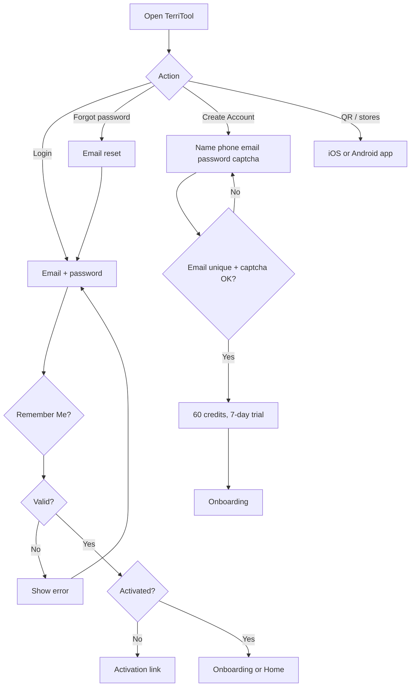
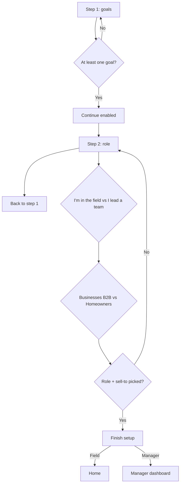

# Authentication Onboarding — flows

Part of [01-Authentication-Onboarding](MODULE.md). Source mermaid in `flows/mmd/`, rendered PNG in `flows/png/` (re-render with `mermaid is inlined in this file`). Product-level map: [FLOWS.md](../../product/FLOWS.md).

## Authentication

## Onboarding

## Mobile flow — LoginRegistrationFlow (added 2026-09-17)

React Native app (`knowledge/architecture/mobile.md`). 6-step onboarding wizard, longer than web's 2-step version — includes an ROI calculator and the subscription paywall inline, which web does not.

1. Login screen (email/password), with validation states — "Please enter password", "Please provide valid login details." (3 similar frames) — UC-AUTH-01. 
2. Onboarding **Step 1 of 6 — "What's the win you're chasing?"**: multi-select goals checklist (Cover more ground, Find leads, Stop wasting gas, Close more deals, Cut sales-tool stack) — UC-ONB-01. 
3. Onboarding **Step 2 of 6 — "Which one's you?"**: role (I'm in the field / I lead a team) + sell-to (Businesses B2B / Homeowners Residential) — UC-ONB-02, UC-ONB-03. Selecting **Residential** is blocked with an alert: *"Sorry but this platform is not for residential reps yet"* — same B2B-only rule as web, enforced here too.  
4. Onboarding **Step 3 of 6 — current tool stack**: multi-select (ZoomInfo, Google Maps, Road Warrior, Apollo, Badger Maps, Spreadsheets, Data Axle Genie) drives a live "you're currently spending $X/mo, Y hrs/wk" calculator, pitched as what TerriTool replaces. **Mobile-only step — no matching UC yet.** 
5. Onboarding **Step 4 of 6 — Sign Up form**: first/last name, phone (+1), email, password, **Sign Up** button. Also has **Preview subscription steps** and a dev-only **Test crash screen** button (not production UX). Validation copy has a real bug — doubled word: *"Please enter Enter Valid Password"* / *"Please enter Enter Valid Email Address"*; also *"The email has already been taken."* (3 similar validation frames) — UC-AUTH-02. 
6. Crash-reporter screen (Sentry-backed, per `mobile.md`): "Something went wrong" — auto-reports, optional free-text note, Send/Retry, copyable support-reference id. Surfaced here because Step 4 can throw; not a dedicated flow step. **No matching UC — candidate for a known-issues entry, not filed as one yet.** 
7. Onboarding **Step 5 of 6 — "Configuring TerriTool for you"**: progress checklist (Setting territory goals → Customizing workflow → Getting leads ready to route). **Mobile-only step.** 
8. Onboarding **Step 6 of 6 — RevenueCat paywall** ("The AI Agent For Field Sales Reps"): Base Plan $69/mo (100 credits) vs. **Enable Free Trial** toggle → 7-Day FREE Trial (60 credits, then $69/mo); rotating testimonial carousel; dev-only **Log out (Dev)** button. Subscribing routes through the native **Sign in to Apple Account** sheet, then a **Processing…** state. **Mobile-only step, paywall is part of onboarding here** — web sells subscription separately (12-Subscription-Payments). No matching UC yet. (4 similar frames — toggle off/on, Apple sign-in sheet, processing) 
9. Back on Login: OS-level **push notification permission** prompt and **App Tracking Transparency (ATT)** prompt ("Allow TerriTool to track your activity across other companies' apps and websites?" — ad personalization, ties to Facebook/TikTok SDKs in `mobile.md`). Both are one-time OS dialogs, not app screens.  
