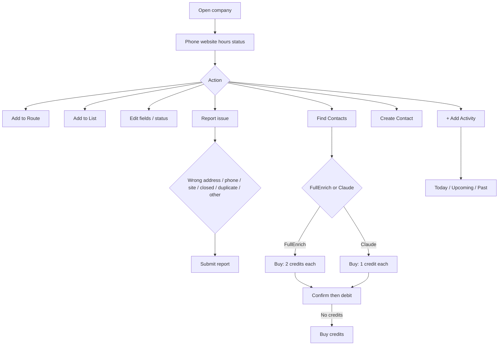
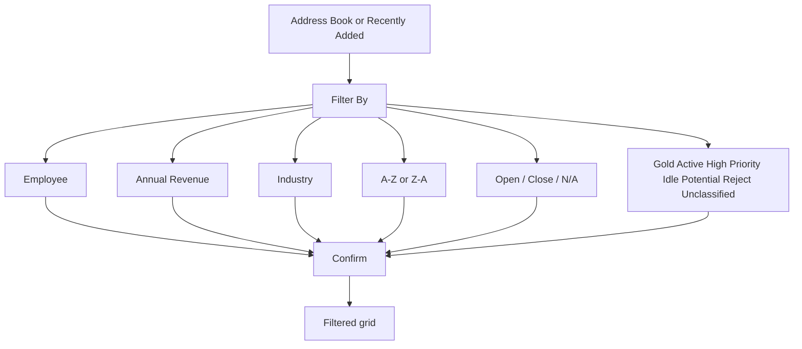

# Company AddressBook — flows

Part of [03-Company-AddressBook](MODULE.md). Source mermaid in `flows/mmd/`, rendered PNG in `flows/png/` (re-render with `mermaid is inlined in this file`). Product-level map: [FLOWS.md](../../product/FLOWS.md).

## Company profile

## Address Book filter

## Mobile flow — AddCompany (added 2026-09-17)

React Native app (`knowledge/architecture/mobile.md`). UC-CO-08 (Add company manually) plus a Search tab web doesn't split out the same way.

1. **Add Company** — **Search** tab (default): Search Company Name (autocomplete), Company Address, Company Website, Company Phone No., collapsible **Add more details** (Industry, Annual Revenue, LinkedIn URL), **Add Company** button. Status pill defaults to "Unclassified". UC-CO-08. 
2. **Add Company** — **Manual** tab: same fields but Company Name is free text instead of autocomplete. UC-CO-08.  (2 similar frames — collapsed/expanded "Add more details")
3. Search tab autocomplete in use: typing "Woodland" returns place matches (Woodland / Woodland Hills / Woodland Park) with city/state; empty state is literally **"There's nothing to show!"** when no match. UC-CO-08. 
4. Selecting a place fills Company Address; Industry/Annual Revenue/LinkedIn can still be hand-filled. (2 similar frames) UC-CO-08. 
5. Header has a **business-card icon** → **Scan Business Card** intro screen ("Snap a card. Save the lead.") with Camera / Gallery capture buttons. This is the entry point into the dedicated Scan Card flow — full capture/review steps: [../04-Contacts/flows.md](../04-Contacts/flows.md) (`ScanCardFlow`), not duplicated here. UC-CO-08 (business-card path). 
6. On submit: toast **"Company has been created and added succe…"** (truncated, real copy), then lands on the new company's profile with **Contacts (0)** / **Activity (10)** panels showing "Loading contacts…" / "Loading activities…" — note the Activity count shows 10 before any activity has loaded for a brand-new company, worth a QA check. UC-CO-08. 

## Mobile flow — AddressBookFlow (added 2026-09-17)

React Native app (`knowledge/architecture/mobile.md`). Covers browsing, contact detail, company detail, filter, and bulk delete — a wider slice than the web evidence set covers in one screenshot pass.

1. **Address Book — Companies tab**: search, filter icon, delete icon, cards (name, address, industry, contact count, colored left-edge status stripe). UC-CO-01. 
2. **Address Book — Contacts tab**: same search pattern, cards show name, company, phone (or "Phone number is not entered"). UC-CT-06. 
3. Header **+** → menu: **Add Company** / **Find Leads**. UC-CO-08. 
4. Add Company — Search tab (same screen as the dedicated AddCompany flow, reached here via the + menu instead). UC-CO-08. 
5. **Add Contact** manual form: First/Last Name, Position, Phone (optional), Mobile (optional), LinkedIn URL (optional), Company Name (optional, autocomplete), City (optional). Cross-reference [../04-Contacts/flows.md](../04-Contacts/flows.md) — not duplicated there since reached from here. UC-CT-03. 
6. Tapping a contact card → **View Contact**: avatar initials, name, status pill, position, LinkedIn / Call / Email / Add To / Delete action row, **Notes** ("No notes yet." + Add Notes). UC-CT-06. 
7. **Add note** modal → toast **"Contact notes has been saved successfully."** → note renders with an Edit Notes button. (3 similar frames — modal, toast, saved state) UC-CT-06. 
8. Contact's **Add To** → **"Add to route"** sheet: lists the user's existing draft/in-progress routes with Route ID and Waypoints count, tap one to add this contact's company as a stop. Mobile-only surface for this action — no direct UC yet, related to UC-RTE. 
9. Selecting a route → **"Updating your sales route"** progress screen (Plotting → Connecting → Optimizing → Wrapping up stages, ETA countdown, "Smart route planning saves 12% of fuel" — same optimizer used by the dedicated Route flow). 
10. Tapping a **company** card → **company detail**, with a **pager** at top ("1 / 6150" — swipe through every company in the book without going back to the list). Same header/action-row/Contacts/Activity layout as web's company popup. UC-CO-04. 
11. **Add Activity** modal: Note, Activity Type (select), Date (defaults today), Time (optional). UC-ACT-01. 
12. Toast **"Activity saved successfully."** → Activity (1) with Today/Upcoming/Past tabs, saved row shows date, note text, **Type: Meeting** pill, edit icon. UC-ACT-01. 
13. **Filter By** sheet: City Name, Zip Code, Industry Type, Company Revenue, Company Employees, Sort By Order, Sort By Availability (N/A / Open / Close), Filter By Status (Idle / Gold / Active / Reject / Potential / Unclassified / High Priority) — matches web's Filter By exactly. (2 similar frames, scrolled) UC-CO-03. 
14. Companies tab **trash icon** → checkboxes appear on every card for multi-select. Mobile-only bulk-select UI, no direct web equivalent found. 
15. **Delete companies** confirm dialog: "Remove 2 companies from your address book? This cannot be undone." Cancel / Delete. UC-CO-09. 

