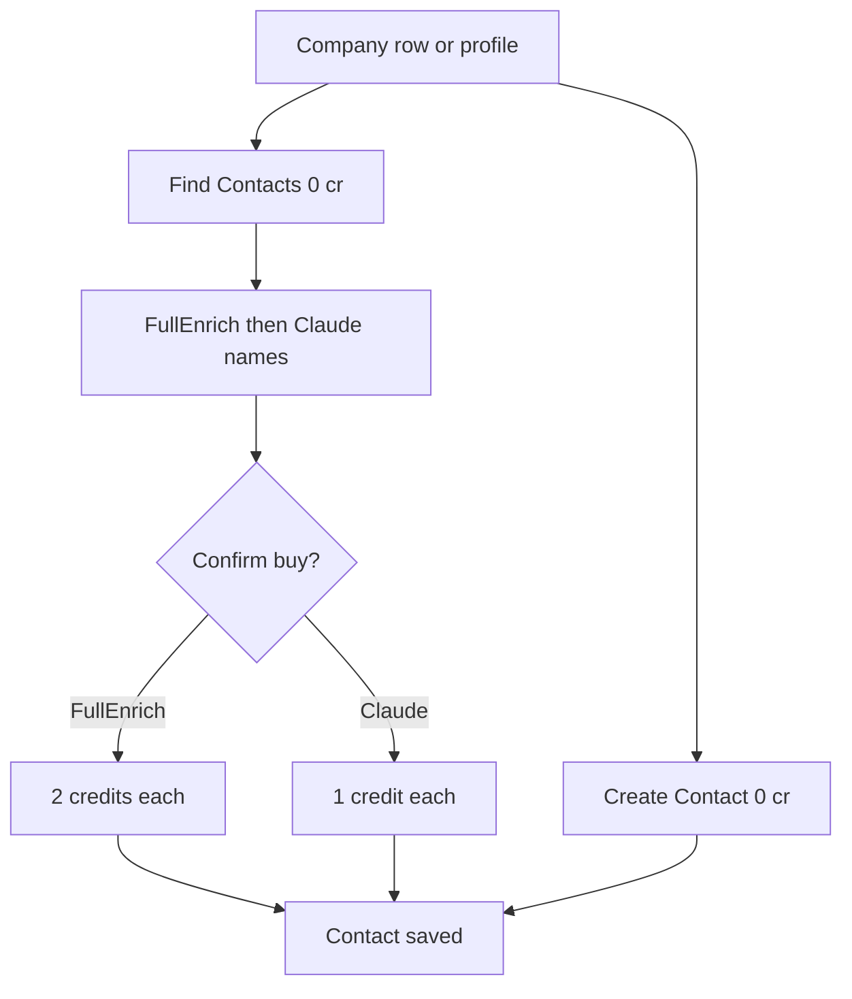

# Contacts — flows

Part of [04-Contacts](MODULE.md). Credits: [09-Contact-Enrichment-Credits](../09-Contact-Enrichment-Credits/flows.md).

## Mobile flow — ScanCardFlow (added 2026-09-17)

React Native app (`knowledge/architecture/mobile.md`). Entry points: Dashboard tile, Add Company header icon (cross-referenced from [../03-Company-AddressBook/flows.md](../03-Company-AddressBook/flows.md)). No web equivalent and no UC id yet — candidate for a new `UC-CT-06` if this becomes a first-class flow.

1. **Scan Business Card** intro: "Snap a card. Save the lead." + Camera / Gallery capture buttons. 
2. OS **Photo Library** permission ("Allow Full Access" / "Limit Access…" / "Don't Allow") when using Gallery. 
3. System photo picker. Test fixture used throughout this flow: a Microsoft/Bill Gates business card image (QA fixture, not real customer data). 
4. **Crop business card** — corner-drag crop UI, rotate/flip controls, Cancel / Choose. (2 similar frames — initial crop, adjusted crop) 
5. **Card Preview** with **"Reading card…"** status, then **"Reading the card… Usually under 5 seconds"** — OCR/AI extraction in progress; **Remove Card** to restart. 
6. **Review details**: "Tap any field to fix a typo or fill what's missing." + **Copy all**. Contact section auto-filled from the card (First Name, Last Name, Position, Email, Phone, LinkedIn) — Email came back empty since the fixture card has none, Phone/Position/Name populated correctly. (2 similar frames — top of form, scrolled to full field list) 
7. Company section, same review pattern: Company Address, City, Industry Type (blank — not on the card), Website (blank), Full Address, **Save Company & Contact** button. 
8. On submit: **"Saving company… Matching the location and saving the company."** 
9. Toast **"Company already exists in your database"** when the matched company/location is already in the Address Book — real duplicate-detection behavior, not an error. 

