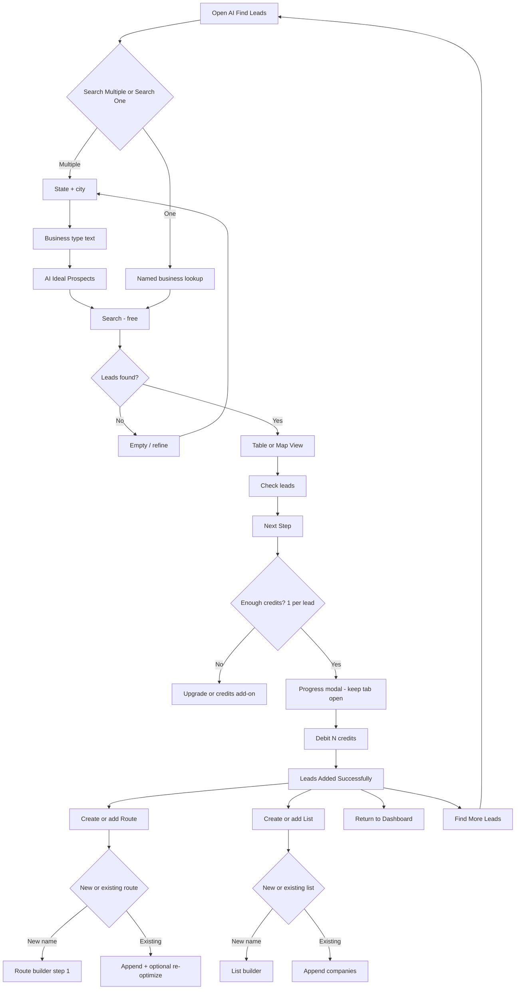

# Find Leads — flows

Part of [05-Find-Leads](MODULE.md). Source mermaid in `flows/mmd/`, rendered PNG in `flows/png/` (re-render with `mermaid is inlined in this file`). Product-level map: [FLOWS.md](../../product/FLOWS.md).

## AI Find Leads

## Mobile flow — AIFindLeadsFlow (added 2026-09-17)

React Native app (`knowledge/architecture/mobile.md`). Same UC-LEAD-01…12 contract as web; screen names differ (tabs instead of a wizard) but the credit/save/route/list logic matches.

1. **AI Find Leads** header: Search Leads / Selected Leads tabs, credits badge. Territory form: City or ZIP toggle, "Ideal businesses" free-text, Clear all / Search. First attempt ("restaurants" + empty ZIP) → **"No matching leads found — try adjusting the city or ZIP, refining your ideal business description, and search again."** UC-LEAD-01. 
2. Filled in properly (ZIP or City + "Bar"/"restaurants") → **Ideal prospects (AI)** summary card (bullet list of what the AI interpreted) appears above the results area. UC-LEAD-01. 
3. **Search progress**: "Searching for companies in {place}… This usually takes about 60 seconds", % bar, named stages (Connecting to data sources → Opening Each Lead → Finding relevant businesses), and 5 source-provider icons — same async multi-stage search as web's `runStage1/2/3`. (3 similar frames — different % complete) UC-LEAD-12. 
4. **Results list**: Ideal prospects summary + **Map** toggle button + result cards (name, address, "N contacts" pill or a **Fetching…** placeholder while contact counts stream in), checkbox per card, sticky **Total: N / Selected: N** bar, Select all / Next step. UC-LEAD-03, UC-LEAD-04. 
5. Checking boxes updates **Selected Leads (N)** tab; **"Enjoying TerriTool? Tap a star to rate it on the App Store"** in-app-review prompt can interrupt here (Not Now / rate) — unrelated to the flow, standard OS/App-Store review nudge. **Selected Leads** tab lists only checked companies with **Confirm Leads**. UC-LEAD-04. 
6. A second search (ZIP `70405`, "Bar") shows the same progress → results pattern, confirming this repeats per search without leaving the screen. (4 similar frames) UC-LEAD-01. 
7. **Map** view of results: pins per lead, **Start/Clear** lasso tool + **List** toggle — same lasso-select pattern as web's route creation, reused here for bulk-selecting leads by drawing a shape around a cluster. UC-LEAD-04. 
8. Lasso drawn around a pin cluster → **End** → matched pins turn blue and get added to Selected automatically (no separate confirm tap needed). (2 similar frames — drawing, result) UC-LEAD-04. 
9. Tapping a result card opens a **preview sheet**: "Once you add this to a route, use Fetch Contacts to unlock full contact details," then **Loading contacts…**, then a masked preview list (e.g. "Garrett Po\*\*\*k", "\*\*\* \*\*\*\*" for names/roles not yet unlocked) — this is the free contact-count preview, matching web's "Find Contacts (0 credits) preview names" rule; nothing is spent here. UC-CT-01-adjacent (contacts module). (2 similar frames) 
10. Selecting fewer than 2 leads and tapping Next step → toast **"Select Atleast 2 Leads"** (copy bug: "Atleast" one word) — "Choose two or more leads from the list or map, then tap…". UC-LEAD-04. 
11. **Select all** → all 29 results selected, **Next step** enabled. Tapping **Confirm Leads** → **"Leads confirmed! Your selected leads are ready."** progress (100% complete). UC-LEAD-05. 
12. **"All selected companies were added to the database. What would you like to do with these companies?"** — **Add to a route** / **Add to a list** / **Return to Dashboard**. This is the save step (1 credit each, matches `save_ai_leads`/`Helper::saveAILead`) — credit debit itself isn't visible in these captures but the destination-choice modal matches web's post-save fork exactly. UC-LEAD-05, UC-LEAD-10. 
13. **Add to a route**: Create New Route (name field + Create Route) or Select Existing Route (dropdown + Add To Route). Typed a new name ("Test Route Brain 0001") → Create Route. UC-LEAD-06, UC-LEAD-07. (3 similar frames — empty, dropdown open, name typed) 
14. **"Leads Added Successfully."** toast → lands in **Create Route** waypoint list (All / Selected (N) / Find Leads / Map View tabs), **Add Company** button, per-row **Not visited yet** status and a colored bar (visit/route-status indicator) — same builder used by the dedicated Route flow. Also has its own **Filter By** sheet (City/Zip/Industry/Revenue/Employees/Sort/Status) identical to Address Book's. UC-RTE (cross-reference [../07-Routes/flows.md](../07-Routes/flows.md)). (5 similar frames) 
15. A separate **Lasso Selection** entry point exists from a zoomed-out world map with clustered counts (e.g. "2883", "817") — for lassoing from the full saved-company universe rather than one search's results. Leads into **Start/End Points**: search or tap-a-pin for Start Point and End Point, small preview map, **Go Back / Create Route**. UC-RTE. (2 similar frames) 
16. **Route Publish** progress: "Generating your sales route — Mapping the smartest route to every stop", %, countdown timer, stage chips (Plotting → Connecting → Optimizing → Wrapping up), **"Smart route planning saves 12% of fuel."** Same optimizer copy as the earlier Address-Book "Add to route" path. Confirms **MCP/mobile create_route always ends up published**, same as `memory/mcp-create-route-publishes.md`. (2 similar frames) UC-RTE. 
17. Lands on the **published route detail** screen: route name as title, share icon, edit pencil, numbered stop list, drive/walk/time segment indicator between stops, bottom tab bar (Home / Search / Contacts / Routes / Lists / Settings). UC-LEAD-06. 
18. **Add to a list**: same Create New List / Select Existing List pattern as routes (typed "Test List Brain 0001"). UC-LEAD-08, UC-LEAD-09. (2 similar frames) 
19. **"Leads Added Successfully."** → **Lists** index (name, date, company count per row) with the new list at top → opening it shows the **List detail**: same per-company row layout as the route builder, Search / Find Contacts / Map View header actions. UC-LEAD-08. (2 similar frames) 

