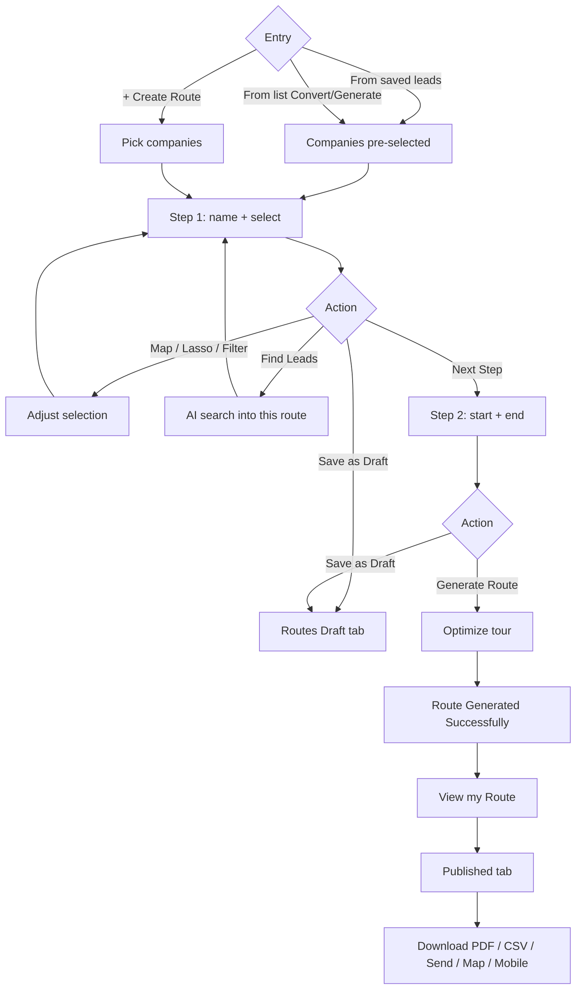
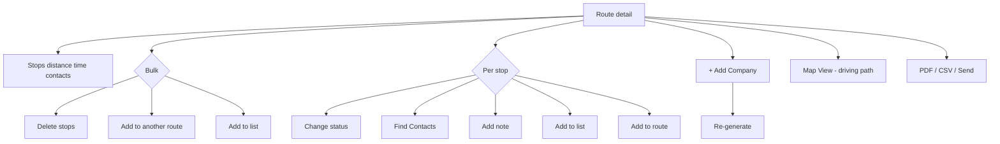

# Routes — flows

Part of [07-Routes](MODULE.md). Source mermaid in `flows/mmd/`, rendered PNG in `flows/png/` (re-render with `mermaid is inlined in this file`). Product-level map: [FLOWS.md](../../product/FLOWS.md).

First published Basic Route mobile-app popup: [screen spec](flows/mobile-app-route-promo-spec.md).

## Create and publish a route

## Work a published route

## Mobile flow — RouteFlow (added 2026-09-17)

React Native app (`knowledge/architecture/mobile.md`). This archive folder also contained 19 frames that are byte-identical to the bulk **Find Contacts** flow already documented in [../08-Lists/flows.md](../08-Lists/flows.md) (same screenshots exported into both folders) — not re-described here to avoid duplicate evidence; see that file for the "tick who to add → Review → background fetch" sequence.

1. **Routes Library** index: search, **+** to create, rows (name, date, waypoint counts, miles, time). UC-RTE-14. 
2. **+** → name modal ("New Route") with live duplicate-name check against existing routes, then a **Filter By** sheet (City/Zip/Industry/Revenue/Employees + sort/status — same fields as Address Book/List). UC-RTE-01. (2 similar frames) 
3. **Add Company** (Search / Manual tabs) reached from the route builder's own **+** — same form as the dedicated Add Company flow. UC-RTE-02. 
4. A background job can fail mid-flow: **crash-reporter screen** ("Something went wrong… Tap Retry to pick up where you left off", auto-reported, support-reference id) — same component as the onboarding crash screen, confirms it's a shared error boundary, not onboarding-specific. 
5. **Lasso Selection** (world map, cluster counts, Start/Clear/End Lasso) → **Start/End Points**: search fields or tap-a-pin, small preview map, "You can remove waypoints from your route on this map," Go Back / Create Route. UC-RTE-03, UC-RTE-06. (4 similar frames) 
6. **Route Publish** progress: "Generating your sales route," stage chips (Plotting → Connecting → Optimizing → Wrapping up), countdown timer, **"Checking drive times to cut fuel and wasted travel,"** **"Smart route planning saves 12% of fuel"** footer, **Preparing Route…** disabled-button state. Confirms mobile create-route **always lands published**, same as [`memory/mcp-create-route-publishes.md`](../../memory/mcp-create-route-publishes.md) documents for MCP. UC-RTE-06. (2 similar frames) 
7. **Published route detail**: title, share icon, edit pencil, **Search stops** bar, hamburger menu (**Map / Find Contacts / Filters**), numbered stop cards with miles/time between each, bottom tab bar. UC-RTE-07. (2 similar frames) 
8. **Map** view of the published route: numbered pins connected by the driving path, blue start marker, red flag end marker, "Loading route on map…" transient state. UC-RTE-13. (2 similar frames) 
9. Map's own **Filters** sheet — same City/Zip/Industry/Revenue/Employees/Sort/Status fields, scrollable. UC-RTE-13. 
10. **Share Route**: email field, "If they already use TerriTool, they will get an email letting them know," inline **"This user does not exist in TerriTool, invite them to continue"** validation, Sharing… state, success + **Past recipients** list. Identical pattern to Share List. UC-RTE-08. (5 similar frames) 
11. **Route stop picker** (All / Selected / Find Leads / Map View tabs) with duplicate-looking rows for the same company at different addresses (data-quality note, not a bug in the picker itself) and an **Add Company** button. UC-RTE-09. 
12. **Single-stop detail** (pager "2/4", swipe between stops): header + **More Info / Mark / Call / Navigate** action row, first-run **coach-mark tooltip** ("Tap Find Contacts to discover people at this company" — Got it / Skip tour), **Contacts (N)**, **Activity (N)** with Today/Upcoming/Past tabs. UC-RTE-10, UC-RTE-11, UC-RTE-12. (2 similar frames) 
13. **More Info** popup (Company Email/Annual Revenue/Category/Employees/Industry, Quick Actions: Call/Website/LinkedIn/Instagram/Facebook, Open & Close) → **Edit** → full **Edit Company** form. UC-RTE-09. (2 similar frames) 
14. **Mark** → **Report company issue** (Wrong address/phone/website, Business closed, Duplicate company, Something else + optional details, Submit report). UC-CO-07-equivalent. (2 similar frames — options list, one selected) 
15. **Add Contact** manual form for a stop (same fields as the dedicated Add Contact flow). UC-CT-03-equivalent. 
16. Single-stop **Find Contacts**: "Finding contacts — Searching Apollo.io…" → **"We looked for contacts and other things"** result (Facebook/Instagram/Business Email Not Found, Contacts 0 People, **"All contacts have already been added… Contacts fetch successfully."**). UC-RTE-11. (2 similar frames) 
17. **Add Activity** modal (Note, Activity Type dropdown: Meeting/Call/Visit/Message/Email/Reminder/Appointment, Date picker, optional Time) → **Schedule**/**Save** → activity appears under the matching Today/Upcoming/Past tab. UC-RTE-12. (4 similar frames — form, date picker, type list, saved) 
18. **Mark Visited** → toast **"You have successfully added the company vi…"** → a **Visit**-type activity is auto-logged with today's date/time; Activity count increments. UC-RTE-10. 
19. Adding an activity dated in the past prompts a **"Past activity — Are you sure you want to add a past activity?"** confirm (Cancel/Continue) before saving; success toast **"Activity saved successfully."** and the entry lands under the **Past** tab. UC-RTE-12. (2 similar frames) 
20. **Report contact issue**: Wrong phone/email, Wrong person/no longer at company, LinkedIn broken, No usable contact info, Something else + optional details, Submit report. UC-CT-04-equivalent. 
21. A **second, pre-existing published route** ("123-XYZ…", 96/98 waypoints) shown in Routes Library demonstrates the row-actions sheet: **View On Map / Edit Route / Re-Route / Delete / Share Route**. Attempting **Re-Route** without a filter set → toast **"Sorry, your route needs filter to use this feat…"** — re-optimizing requires a filter/subset first, a real validation constraint worth testing. UC-RTE-15. (3 similar frames) 
22. **Delete Route** confirm ("Are you sure you want to delete this route?" Cancel/Delete). UC-RTE-09. 
23. **Edit route name** inline (pencil field + checkmark) → toast **"Route Updated Successfully"**, name updates in the library list immediately. UC-RTE-09. (2 similar frames) 
