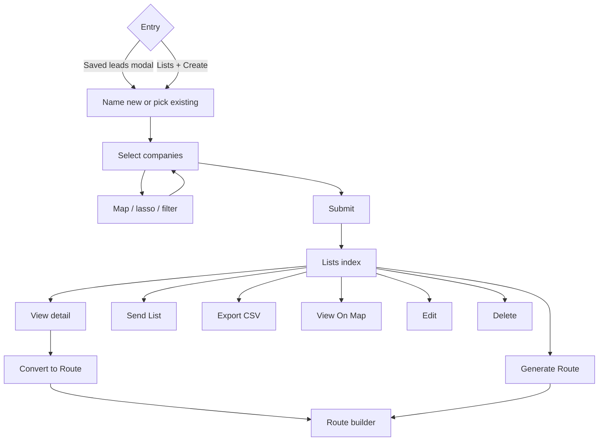

# Lists — flows

Part of [08-Lists](MODULE.md). Source mermaid in `flows/mmd/`, rendered PNG in `flows/png/` (re-render with `mermaid is inlined in this file`). Product-level map: [FLOWS.md](../../product/FLOWS.md).

## Lists

## Mobile flow — List (added 2026-09-17)

React Native app (`knowledge/architecture/mobile.md`). This capture set actually opens on the multi-stop **bulk Find Contacts** flow (shared UI between Routes and Lists — one capture literally shows it under a screen titled "Route"), then moves into the dedicated Lists screens proper.

1. **Bulk Find Contacts, per-stop**: "Tick who to add. The price sits on each person." — stop N of 4, people list with **Owner · added before** rows pre-checked, others unchecked. UC-CT-01-adjacent (bulk). 
2. Mid-search overlay: **"Finding contacts — Searching Apollo.io for emails, phones, and company data… We start with partner databases running in parallel. If we need more contacts, additional public directories are searched next."** (2 similar frames — different stops) 
3. Selecting people updates a running **"N selected · N credits"** bar and unlocks **Review**. 
4. **Find Contacts** (multi-stop) index: "Tap View on a stop, tick the people you want, then Review. **Nothing is charged until you confirm.**" Per-stop cards show N added-before / N found and a **View** or **"N selected"** button. 
5. **Review**: per-stop grouped list, red **–** to drop anyone, cost breakdown (Phone or email = 2 credits, Name and position = 1 credit), **Total N credits · you have N** balance, footer note **"Phones and emails take about a minute to arrive. Anyone that comes back empty is not charged."** — confirms the "not charged if empty" credit-safety rule mentioned in the web glossary is enforced here too. UC-CT-01. 
6. After confirming, the fetch continues **in the background** — a persistent progress sheet ("Getting details for N contacts… 0 ready · keep driving") stays visible even after navigating to the route/list detail screen underneath, then updates to **"All N contacts ready."** UC-CT-01/UC-CT-02 (async background fetch, no dedicated UC id for the "keep driving" persistence). (2 similar frames) 
7. **Single-company Find Contacts** (opened from a company profile's Contacts panel): Contacts (N) list already on file, **Add Contact** / **Find Contacts** buttons. UC-CT-01. 
8. Single-company **Find Contacts** search screen: company website field, Name/Position/City filters, **Search / Reset / All Done**, result rows with per-contact **Add**, and a **Search secondary database** button that runs Better Business Bureau / other public-directory lookups when the primary source comes up short — same FullEnrich→secondary-source waterfall concept as web, phrased differently. (4 similar frames — idle, searching, taking-longer, secondary-source) UC-CT-01. 
9. Result of a secondary-database pass: **"We looked for contacts and other things"** — Facebook/Instagram/Business Email lookup results, plus **"All contacts have already been added"** / **"Contacts fetch successfully"** confirmations. Not previously documented anywhere in this Brain. 
10. **Lists index**: search, **+** to create, rows (name, date, company count), collapsible "show more". UC-LST-06. 
11. Row actions sheet: **View On Map / Edit List / Generate Route / Delete / Share List**. Edit List reveals an inline rename field. UC-LST-06, UC-LST-08. (2 similar frames — actions sheet, rename field) 
12. **Share List**: email field, **"If they already use TerriTool, they will get an email letting them know,"** inline validation (**"This user does not exist in TerriTool, invite them to continue"**), success state with a **Past recipients** list. Mobile-only richer version of web's list sharing. (3 similar frames) 
13. **Create List** (from + on the index): All / Selected / Find Leads / Map View tabs, company rows with checkboxes, **Select All** (fetches the entire Address Book — "Selecting All Companies… Fetching all companies from server," landed on 6,150 selected), **Next Step** → name modal → **Save List**. UC-LST-02, UC-LST-05. (4 similar frames) 
14. Builder's **Add Company** menu (**Add Company** / **Find Leads**) — same entry points as the Route and Address-Book builders. UC-LST-03. 
15. **Lasso Selection** map (Clear/Start Lasso, world-map cluster counts) — same lasso tool reused from Routes/Find Leads, here for picking existing Address Book companies into a list. UC-LST-04. (2 similar frames) 
16. New list lands on its **List detail**: per-company rows with **Contacts: N** or **Visited …**, header **Find Contacts** / map icon, edit pencil. UC-LST-07. (2 similar frames) 
17. Detail-screen hamburger menu: **Map / Find Contacts / Filters**. **Filters** sheet: City Name, Zip Code, Industry Type, Company Revenue, Company Employees, Sort By Availability (N/A/Open/Close), Sort By Visit (N/A/Visited/Non-Visited), Filter By Status (Idle/Gold/Active/Reject/Potential/Unclassified/High Priority) — same field set as Address Book's Filter By. UC-LST-07. (3 similar frames) 

