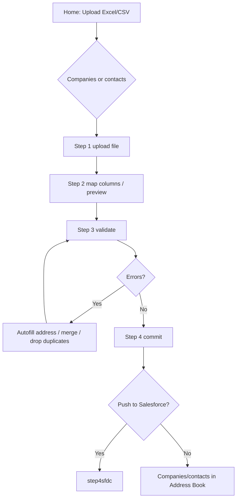

# Bulk Upload — flows

Part of [10-Bulk-Upload](MODULE.md). Source mermaid in `flows/mmd/`, rendered PNG in `flows/png/` (re-render with `mermaid is inlined in this file`). Product-level map: [FLOWS.md](../../product/FLOWS.md).

## Upload Excel / CSV

