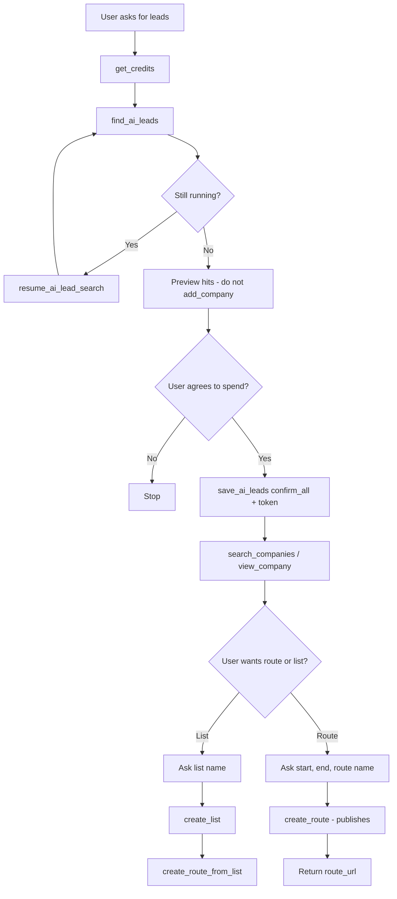
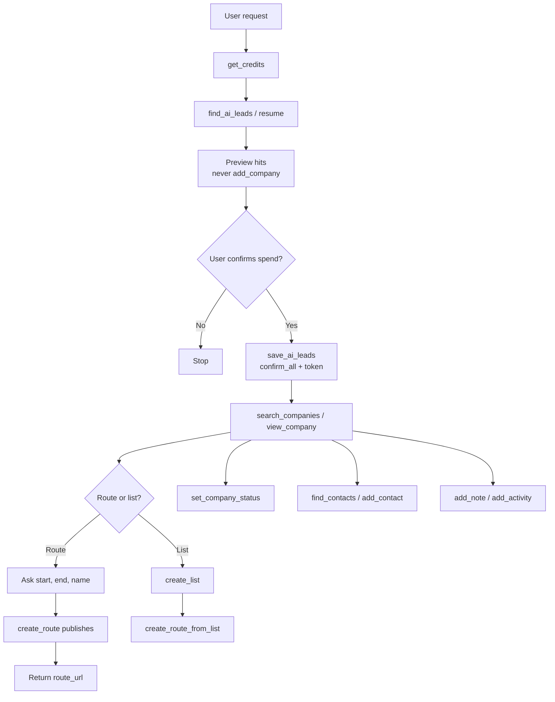

# MCP — flows

Part of [20-MCP](MODULE.md). Source mermaid in `flows/mmd/`, rendered PNG in `flows/png/` (re-render with `mermaid is inlined in this file`). Product-level map: [FLOWS.md](../../product/FLOWS.md).

ChatGPT public setup landing (`/chatgpt-plugin`): [flows/chatgpt-setup-index-spec.md](flows/chatgpt-setup-index-spec.md). Order is install MCP → create Project → use MCP in a chat.

## MCP agent lead-to-route

## MCP agent use cases

