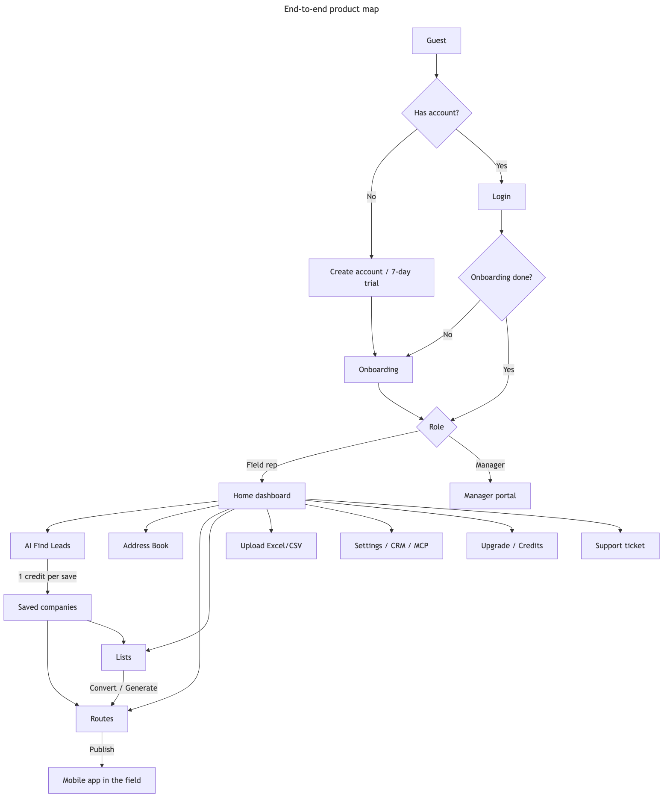
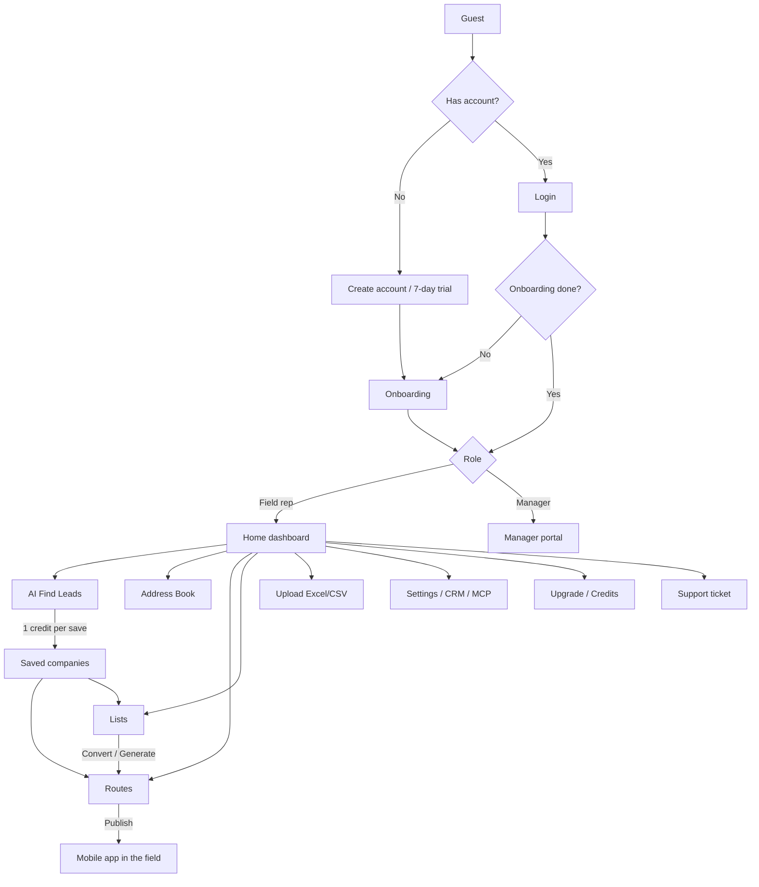
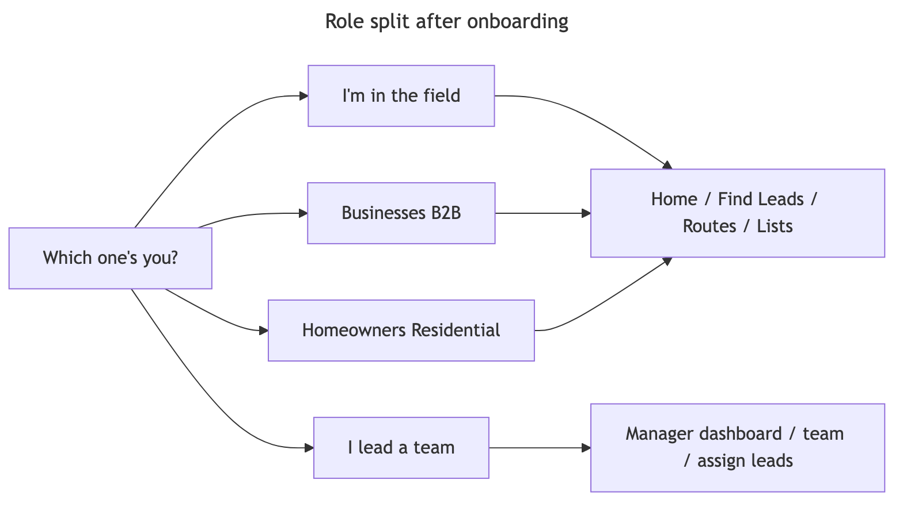
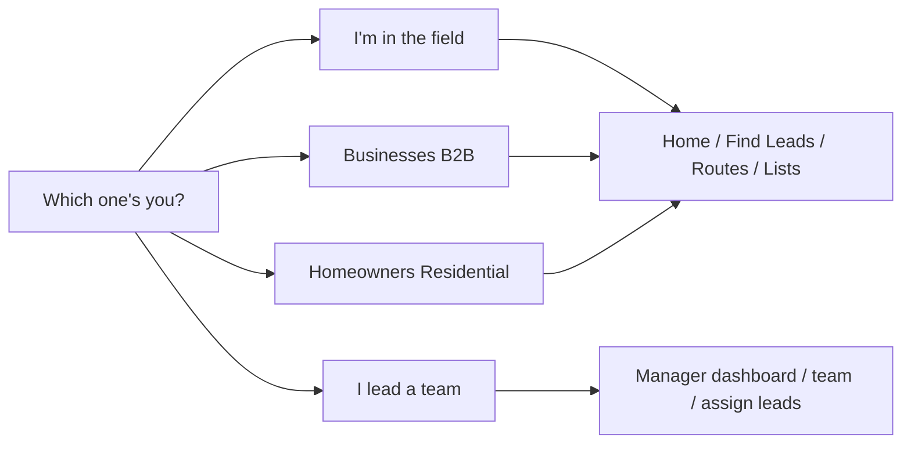
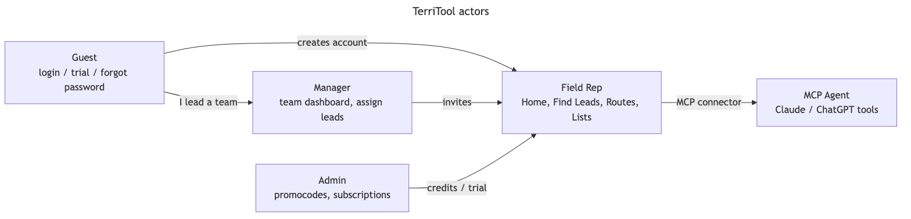
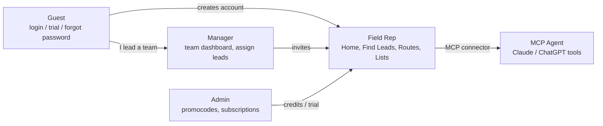
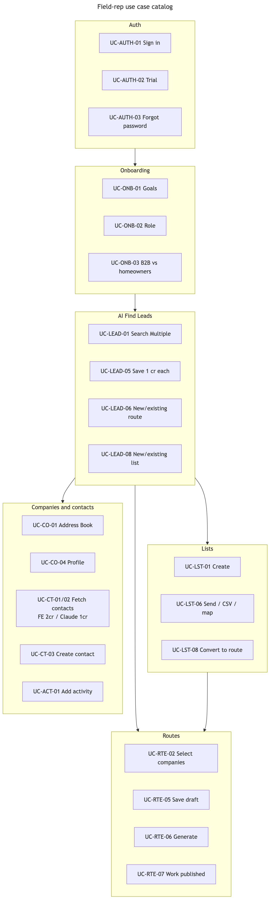
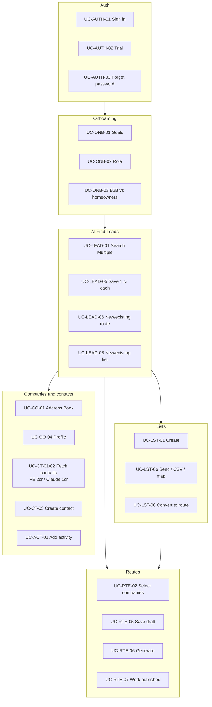
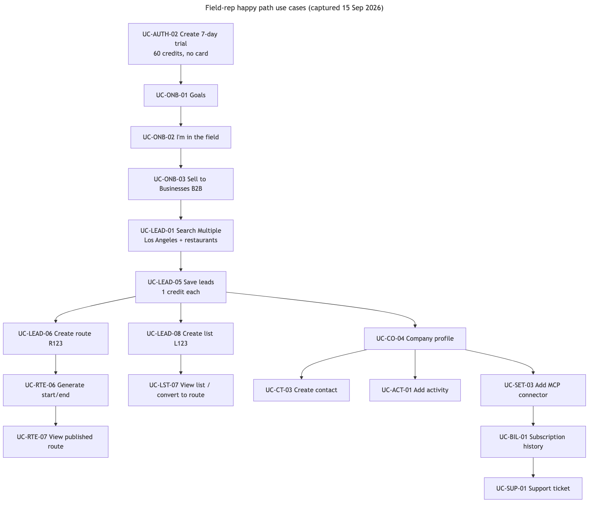
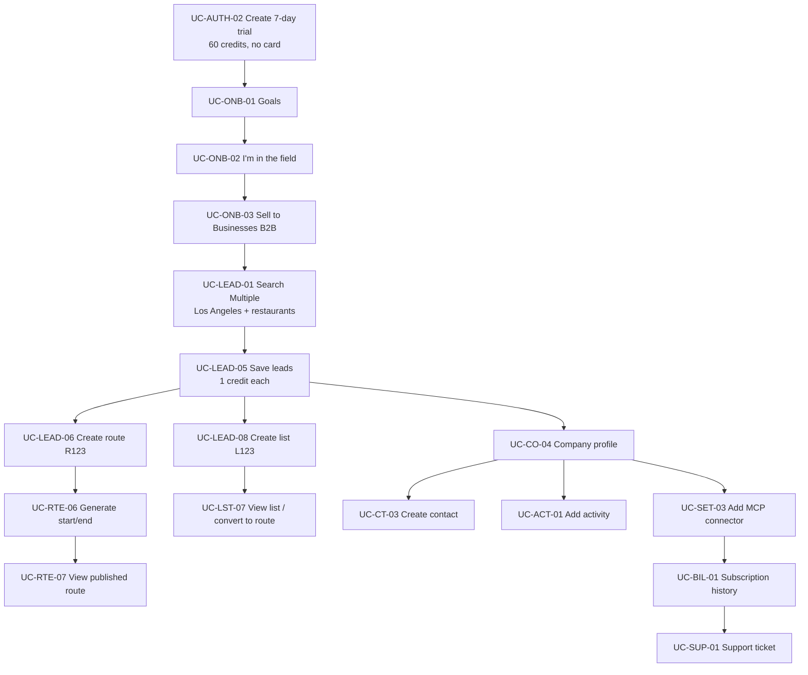

# Product-level flows

End-to-end map, role split and the use-case overview diagrams. Feature-level flows live beside each module in `features/<module>/flows.md`; the index is in [features/README.md](../features/README.md) and [../ui-flows/README.md](../ui-flows/README.md).

Mermaid source copies: `../ui-flows/source/product/`. Rendered PNGs: [flows/png/](flows/png/).

## End-to-end product map

## Role split after onboarding

## TerriTool actors

## Field-rep use case catalog

## Field-rep happy path use cases (captured 15 Sep 2026)

## Rules these diagrams encode

1. Search AI leads is free; **save costs 1 credit per lead**.
2. After save, next action is new/existing **route**, new/existing **list**, dashboard, or find more.
3. Routes have **Draft** vs **Published**. Generate requires start/end (or MCP auto-tour).
4. Lists are unordered until **Convert / Generate Route**.
5. Buy/fetch contacts is **not free**: FullEnrich **2** credits, Claude **1** credit. Never `add_company` for AI search hits — use `save_ai_leads`.
6. MCP Chat/Sync asks before Fetch/Send/Update. Blocked if not connected.
