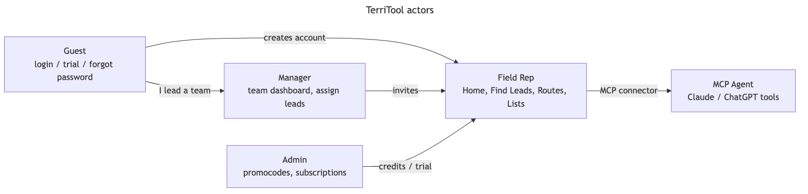
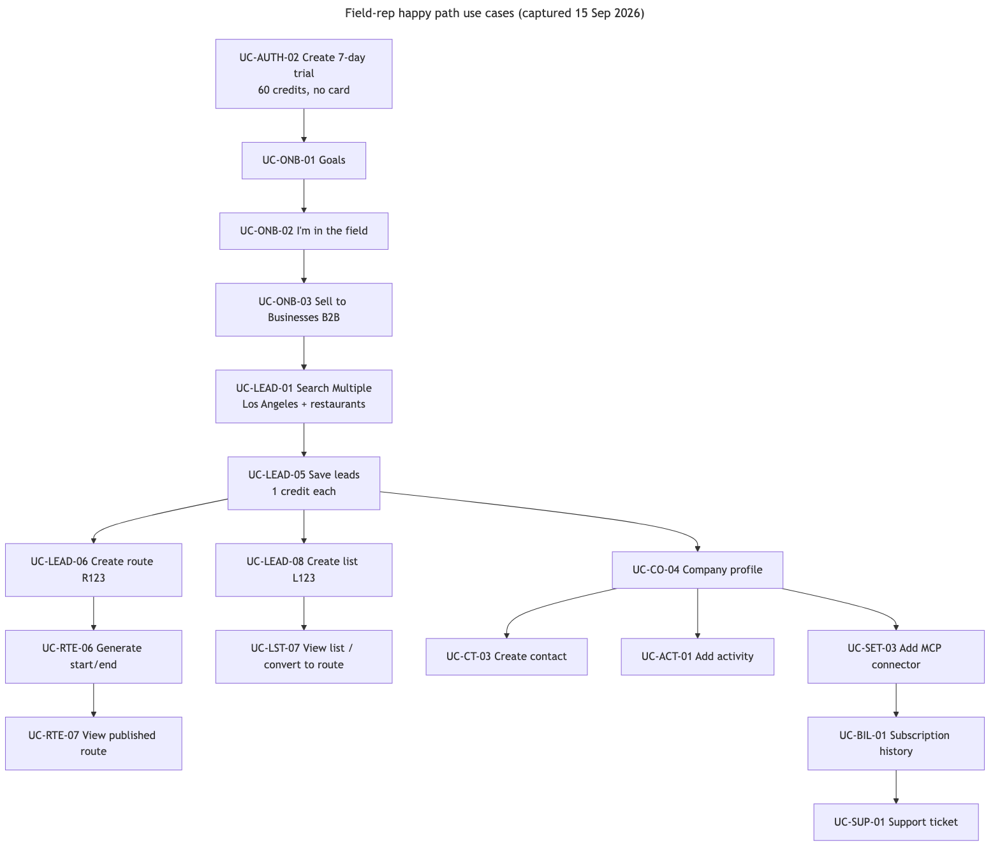
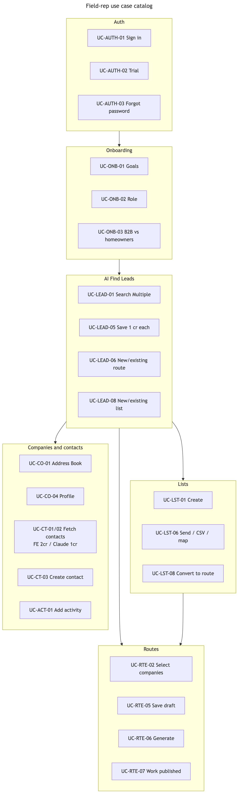

# TerriTool use cases

Actors, preconditions, main flow, alternate paths, and exceptions for every product flow. Evidence lives beside each feature (`features/<module>/evidence/`) plus `routes/web.php`. The per-feature use cases are linked in the table below.

**Rendered images for the AI brain:**

Full PNG index: [UI Flows README](flows.md).

## Actors

| Actor | Who | Typical entry |
|---|---|---|
| Guest | Unauthenticated visitor | `/`, login, trial signup |
| Field Rep | Sales agent (`I'm in the field`) | Home, Address Book, AI Find Leads, Routes, Lists |
| Manager | Team lead (`I lead a team`) | `/manager/dashboard` |
| Admin | Back-office operator | Admin CRUD, promocodes, subscriptions |
| MCP Agent | Claude / ChatGPT / custom MCP client | Find MCP + User MCP tools |

## Global chrome (every authenticated page)

- **Upgrade** (billing)
- **Credits** badge (opens credits / invoice)
- Google Play / App Store
- **Report Bug** → support ticket
- **Logout**
- Sidebar: Home, Address Book, AI Find Leads, Recently Added, Routes, Lists, Settings

## Use cases by feature

| Feature | Use-case IDs | File |
|---|---|---|
| [01-Authentication-Onboarding](../features/01-Authentication-Onboarding/MODULE.md) | UC-AUTH-01 … UC-ONB-03 | [use-cases.md](../features/01-Authentication-Onboarding/use-cases.md) |
| [02-Dashboard](../features/02-Dashboard/MODULE.md) | UC-HOME-01 … UC-HOME-05 | [use-cases.md](../features/02-Dashboard/use-cases.md) |
| [03-Company-AddressBook](../features/03-Company-AddressBook/MODULE.md) | UC-ACT-01 … UC-CO-10 | [use-cases.md](../features/03-Company-AddressBook/use-cases.md) |
| [04-Contacts](../features/04-Contacts/MODULE.md) | UC-CT-03 … UC-CT-05 | [use-cases.md](../features/04-Contacts/use-cases.md) |
| [05-Find-Leads](../features/05-Find-Leads/MODULE.md) | UC-LEAD-01 … UC-LEAD-12 | [use-cases.md](../features/05-Find-Leads/use-cases.md) |
| [06-Recently-Added](../features/06-Recently-Added/MODULE.md) | UC-CO-02, UC-CT-06 | [use-cases.md](../features/06-Recently-Added/use-cases.md) |
| [07-Routes](../features/07-Routes/MODULE.md) | UC-RTE-01 … UC-RTE-15 | [use-cases.md](../features/07-Routes/use-cases.md) |
| [08-Lists](../features/08-Lists/MODULE.md) | UC-LST-01 … UC-LST-08 | [use-cases.md](../features/08-Lists/use-cases.md) |
| [09-Contact-Enrichment-Credits](../features/09-Contact-Enrichment-Credits/MODULE.md) | UC-CT-01, UC-CT-02 | [use-cases.md](../features/09-Contact-Enrichment-Credits/use-cases.md) |
| [10-Bulk-Upload](../features/10-Bulk-Upload/MODULE.md) | UC-UPL-01 … UC-UPL-03 | [use-cases.md](../features/10-Bulk-Upload/use-cases.md) |
| [12-Subscription-Payments](../features/12-Subscription-Payments/MODULE.md) | UC-BIL-01 … UC-BIL-05 | [use-cases.md](../features/12-Subscription-Payments/use-cases.md) |
| [13-CRM-Integrations](../features/13-CRM-Integrations/MODULE.md) | UC-SET-02 … UC-SET-05 | [use-cases.md](../features/13-CRM-Integrations/use-cases.md) |
| [14-Settings-Profile](../features/14-Settings-Profile/MODULE.md) | UC-SET-01, UC-SET-06 | [use-cases.md](../features/14-Settings-Profile/use-cases.md) |
| [15-Support-Notifications](../features/15-Support-Notifications/MODULE.md) | UC-SUP-01, UC-SUP-02 | [use-cases.md](../features/15-Support-Notifications/use-cases.md) |
| [16-Manager-Portal](../features/16-Manager-Portal/MODULE.md) | UC-MGR-01 … UC-MGR-05 | [use-cases.md](../features/16-Manager-Portal/use-cases.md) |
| [17-Admin-HQ](../features/17-Admin-HQ/MODULE.md) | UC-ADM-01 … UC-ADM-09 | [use-cases.md](../features/17-Admin-HQ/use-cases.md) |
| [20-MCP](../features/20-MCP/MODULE.md) | §15 tool table | [use-cases.md](../features/20-MCP/use-cases.md) |

---

## Cross-flow decision (happy path captured in this Brain)

Guest → trial signup → goals + field + B2B → Find Leads (LA restaurants) → save (credits) → create route `R123` → generate → view stops → save more leads → create list `L123` → convert/map → inspect Address Book / company / contact / activity → Settings MCP + subscription → Support ticket.
