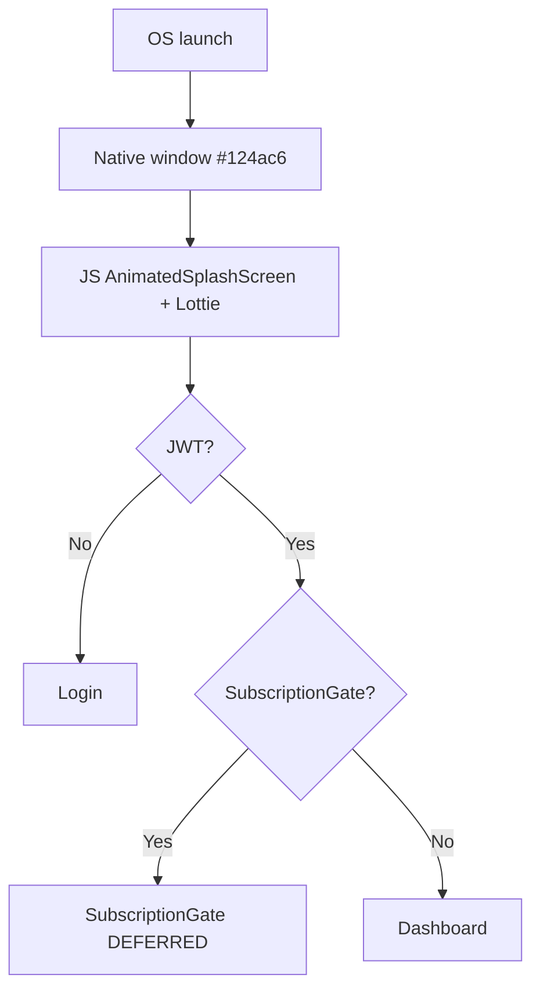

# App launch

Splash stills were not provided. Minimum JS splash duration is ~3s in code.

**Needs Manual Verification:** exact splash animation vs native launch image.

%% brain-links:start %%
<!-- generated by tools/obsidian-sync.js from brain/audits/data/brain-index.json; edits here are overwritten -->

## Linked (4)

**Documents (4):** [[brain/assets/brand/flow-notes/README|04 — User flows]] · [[brain/assets/MANIFEST|Design library manifest (generated: do not edit)]] · [[brain/context/flows|Product features list]] · [[_code/brain/tools/obsidian-sync.js|Renders the brain index as an Obsidian vault.]]

%% brain-links:end %%
