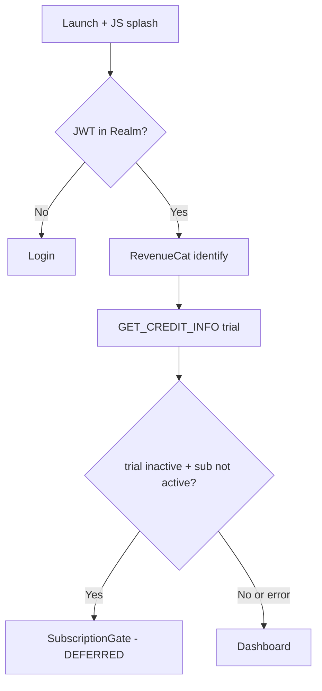
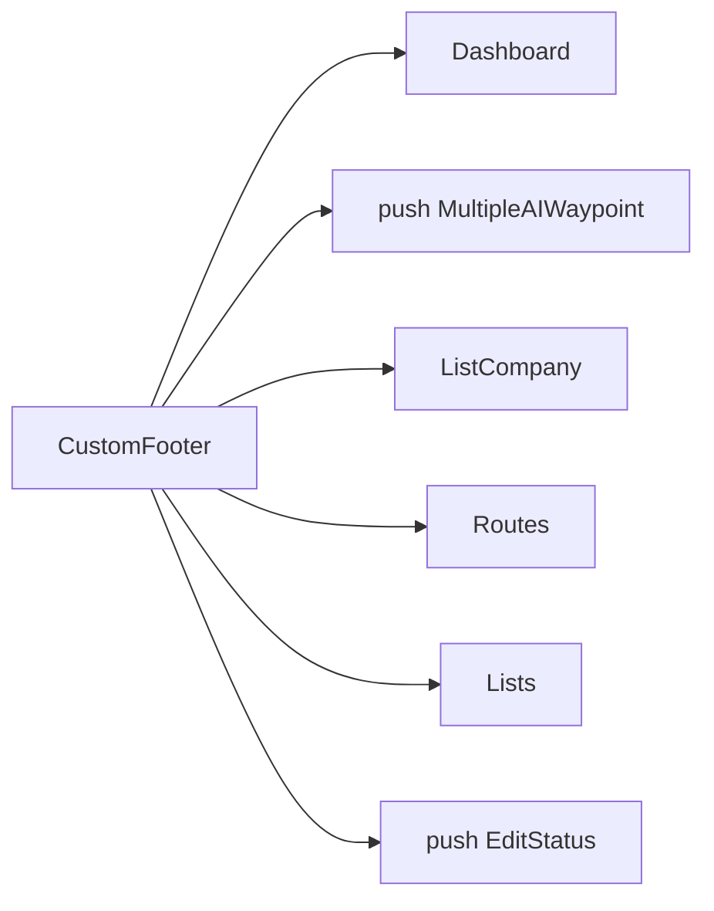
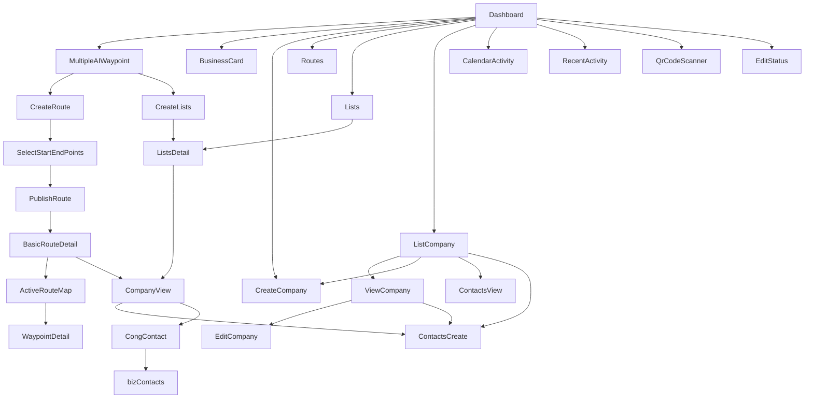

# Navigation

## Root

- `@react-navigation/native` + `@react-navigation/native-stack` v7
- **No** bottom-tabs, drawer, or nested stacks
- Persistence key `@TerriTool_nav_state` — restore **does not** reopen last deep screen (`initialState` cleared)
- `headerShown: false` everywhere

## Cold start

Login success uses the same gate. Gesture back disabled on Login and Dashboard.

## Footer (not React Navigation tabs)

Find Leads and Settings **push**; others **navigate**. Dashboard **does not render** the footer; Home still targets Dashboard.

iOS native **stack push animation** is visible in VID3 (`x3_t28s`): previous screen peeks from the left.

## Module map (in-scope)

## Deep links / FCM

- Info.plist URL scheme is Facebook SDK, not in-app routing
- Referral Dynamic Link `https://territoolapp.page.link/App` is **share copy**, not a JS router
- FCM logs notification opens; **does not** `navigate("Notifications")`

**Needs Manual Verification:** native Firebase handling of Dynamic Links after install.

## Dead / broken

| Name | Issue |
| --- | --- |
| Notifications | Registered, never navigated |
| RouteSwipe | Registered, never navigated |
| FilterList / FilterRoute / stack FilterModule | Unused; FilterModule is a component |
| ClusterList | Navigated, **not registered** |
| CustomCompany stack | Usually embedded |

%% brain-links:start %%
<!-- generated by tools/obsidian-sync.js from brain/audits/data/brain-index.json; edits here are overwritten -->

## Linked (5)

**Documents (5):** [[brain/assets/brand/ui-notes/README|02 — User Interface]] · [[brain/assets/MANIFEST|Design library manifest (generated: do not edit)]] · [[_code/brain/tools/obsidian-sync.js|Renders the brain index as an Obsidian vault.]] · [[brain/audits/08-design-brain-review|Review of the old Design-Brain]] · [[brain/assets/brand/design-brain-root/MASTER-DESIGN-BRAIN|TerriTool Mobile — Master Design Brain]]

%% brain-links:end %%
