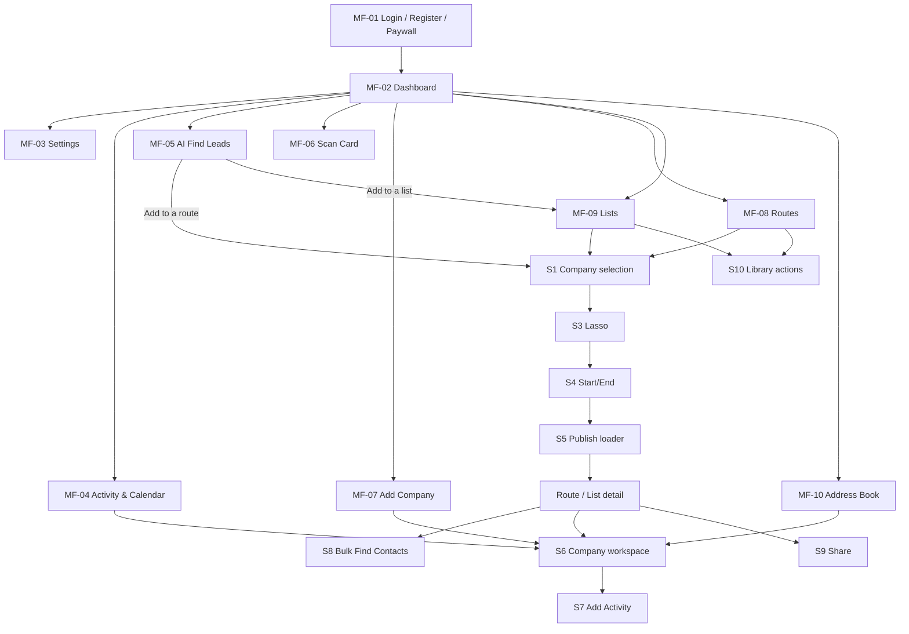

# Mobile flows from the owner's captures (2026-09-15)

## Source

- **Captures:** 249 screenshots the owner put in `shoebox/02-mobile/screenshots/` (10 flow folders), taken 2026-09-15 19:26–20:34 on the iPhone 17 Pro Max simulator.
- **Build:** 42.32 (1), a **Development** build pointed at **staging** (header strip "App 42.32 (1) · iOS · Development (S)").
- **Library copies:** `brain/assets/screenshots/mobile-owner/<folder>/`.
- **Screenshot IDs** (`LR-01`, `RT-17`…) are stable. Each ID maps to its file in `brain/context/mobile-screenshot-index.md` (generated by `node tools/index-owner-screenshots.js`).
- **Plain names:** every screenshot has a plain-language name (what the screen shows) in `brain/audits/data/owner-mobile-capture-names.json`. Names for non-technical readers (journeys, steps, shared parts, screens, documents, rules) are in `brain/audits/data/friendly-names.json`. The screenshot index and the brain graph use both files.
- **Duplicates:** 20 exact duplicates are kept on purpose. They are the same screens reused by the Route and List flows. **Videos:** 24 owner recordings arrived on 2026-09-16; see `mobile-videos.md`.

**Method:**
- Every one of the 229 unique screens was viewed.
- Screen identity was confirmed against header titles in code (e.g. `route/contact/review.js:176` "Review", `activeroutemap/waypointdetail.js` "Waypoint Details").
- Step order comes from the capture timestamps.

**What these flows are:** descriptions written by Claude from the captures. They are **not** product specifications. Where a capture doesn't show something (e.g. the success path of Scan Card), it is marked "not captured".

**Personal data:** the captures show staging test accounts and test data. No emails or phone numbers are copied into this file.

## 0. Map

## 1. Shared sub-flows (the same screens reused by several flows)

| ID | Sub-flow | How it works (as captured) | Screens | Used in |
|---|---|---|---|---|
| **S1** | Company selection | Search "Search Company (Waypoint)". Chips **All / Selected (n)** (filter) plus **Find Leads** (menu: Add Company / Find Leads, sky fill) and **Map View** (gold fill). Rows show checkbox, name, address, industry, visited date and a status stripe. **Select All** runs "Selecting All Companies… Fetching all companies from server" → "All Done! 6150 companies selected" and the button becomes Unselect All. Footer CTA is **Create Route** (route), **Next Step** (edit) or **Submit** (list). "Add Company" pill under the selected list | AI-32–35, RT-06–12, RT-33, LS-28–31, LS-33 | MF-05, MF-08, MF-09 |
| **S2** | Filter By sheet | City Name, Zip Code, Industry Type, Company Revenue, Company Employees, Sort By Order A–Z/Z–A, Sort By Availability N/A/Open/Close. **Sort By Visit** N/A/Visited/Non-Visited appears on route map, route/list detail and list filters, but **not** on company selection or Address Book. Filter By Status (Idle, Gold, Active, Reject, Potential, Unclassified, High Priority). "Scroll for more" hint; Clear Filter / Filter | AI-36–37, RT-04–05, RT-24, RT-27, LS-41–42, AB-15–16 | MF-05, MF-08, MF-09, MF-10 |
| **S3** | Lasso Selection | Header shows credits. "Please wait…" while the map loads, then clustered map. **Start Lasso** → draw → **End Lasso** (teal) → **Next Step**; **Clear Lasso** (red). Inside AI Find Leads the map has Clear / Start / End / List controls | AI-16–19, AI-38–39, RT-15–17, LS-34–35 | MF-05, MF-08, MF-09 |
| **S4** | Start/End Points | Instruction text, **Start Point** (green) and **End Point** (red) address dropdowns, map with pins, "You can remove waypoints from your route on this map."; Go Back / Create Route | AI-40, RT-18 | MF-05, MF-08 |
| **S5** | Route publish / update loader | "ROUTE PUBLISH · Generating your sales route". Step text changes ("Mapping the smartest route to every stop", "Checking drive times to cut fuel and wasted travel"). % complete, countdown timer, stage chips Plotting / Connecting / Optimizing / Wrapping up, disabled "Preparing Route…", "Smart route planning saves 12% of fuel". Update variant: "ROUTE UPDATE · Updating your sales route" | AI-41–42, RT-19–20, AB-11 | MF-05, MF-08, MF-10 |
| **S6** | Company workspace | Name, status dot, edit pencil, address, action pills. **Route/list stop:** pager `n / N` with More Info, **Mark**, Call, Navigate, plus **Add Activity + Mark Visited**. **Address Book / calendar:** More Info, **Add To**, Call, Navigate, plus **Add Activity only**. Contacts (n) with Report, Add Contact, Find Contacts. Activity (n) with Today / Upcoming / Past tabs. Parts: • First-use spotlight "Find contacts… Got it / Skip tour" • More Info sheet (email, revenue, category, employees, industry, quick actions, open & close) • Edit Company • (i) route info → **Report company issue** (6 reasons, Submit disabled until chosen) • **Report contact issue** (6 reasons) • "Contact will be displayed here after it is migrated." banner | RT-45–53, RT-63–64, RT-66, RT-72, RT-76, AB-12–14, AC-09, CAL-04 | MF-04, MF-07, MF-08, MF-10 |
| **S7** | Add Activity | Note, **Activity Type** (Meeting, Call, Visit, Message, Email, Reminder, Appointment), **Date** (defaults to today, calendar picker), **Time (optional)** wheel picker. • CTA reads **Save** for today or past dates and **Schedule** for future dates. • No type chosen → "Please select an activity type." • Past date → system alert "Past activity — Are you sure you want to add a past activity?" (Cancel / Continue). • On success → "Activity saved successfully." • **Mark Visited** adds a "Visited <date>, <time> · Type Visit" entry with a remove control | RT-54–62, AB-13–14 | MF-08, MF-10 |
| **S8** | Bulk Find Contacts | **Find Contacts** screen shows "<route> · N stops" and "Tap View on a stop, tick the people you want, then Review. Nothing is charged until you confirm." • Progress: "Finding contacts · 0 of 4 stops · Checking FullEnrich…" → "All 4 stops checked · 4 have people". • Per stop: "N added before · N found" + **View**. • **Stop people** screen (company name, "Stop 3 of 4"): "Tick who to add. The price sits on each person."; people rows show "Phone · Email · 2 credits"; people already added are ticked "added before"; overlay "Searching Apollo.io for emails, phones, and company data…". • **Review** ("<route> · N selected"): drop people with the red circle. Summary: **Phone or email = 2 credits each, Name and position = 1 credit**, "Total 5 credits · you have 8,388". "Phones and emails take about a minute to arrive. Anyone that comes back empty is not charged." → **Confirm 3 contacts · 5 credits**. • Background sheet "Getting details for 3 contacts · 0 ready · keep driving" → "All 3 contacts ready" | RT-34–44, RT-65 (duplicates LS-01–19) | MF-08, MF-09 |
| **S9** | Share by email | "Share Route" / "Share List": explanation, email field, Cancel / Share. • Unknown user → red "This user does not exist in TerriTool, invite them to continue". • Success → green "Route has been sent to …" plus a **Past recipients** list | RT-28–32, LS-24–26, LS-38 | MF-08, MF-09 |
| **S10** | Library item actions | Row "…" opens a sheet: name card (tap to rename inline with a check button), **View On Map**, **Edit Route/List**, **Re-Route** (routes) / **Generate Route** (lists), **Delete** (red confirm), **Share Route/List** (primary). • Confirms: "Are you sure you want to re-route?" (Cancel / OK), "Delete Route · Are you sure…" (Cancel / red Delete). • Toasts: "Route Updated Successfully", "List Updated Successfully" | RT-73, RT-77–81, LS-21–23 | MF-08, MF-09 |
| **S11** | Add Company form | Status header "Unclassified" + edit. **Search** (company-name autocomplete → address autofill) or **Manual** (company name). Website, phone, **Add more details** (industry, annual revenue `$XXX,XXX`, LinkedIn). **Add Company** → "Company has been created and added succe…" → company workspace. Header card icon → Scan Business Card. Title reads **"Add Company"** from Dashboard/Create Route but **"Address Book"** from Address Book and Create List (`company/create/index.js`) | AC-01–09, RT-13, LS-32, AB-04 | MF-07, MF-08, MF-09, MF-10 |
| **S12** | System and overlays | **Permission prompts:** notifications (LR-16), App Tracking Transparency (LR-17), location (DB-01), camera (DB-04), photo library (SC-02). **Crash fallback:** "Something went wrong · Report sent automatically · What were you doing? · Send / Retry · Support reference" (LR-09 dev test, RT-14 captured as a reference; neither is a real crash, USER SAID 2026-09-15). **Other:** "New Update Available" (ST-02), App Store rating prompt "Enjoying TerriTool?" (AI-10), top toasts (orange = error, green = success) | as listed | all |

## 2. Flows

### MF-01 Login, registration and paywall (LR) · F01, F02, F03

| # | Screen | What happens | IDs |
|---|---|---|---|
| 1 | Login | TT cube logo, Email, Password (eye toggle), Forgot Password?, **Login**, **Register Here** (outline), footer Terms Of Use (EULA) · version · Privacy Policy | LR-01 |
| 1a | Login errors | Top toast "Please enter password" (empty password); "Please provide valid login details." (wrong credentials) | LR-02, LR-03 |
| 1b | After login | System prompts: notifications, then App Tracking Transparency, then Dashboard (location prompt DB-01) | LR-16, LR-17 |
| 2 | Register · Step 1 of 6 | "What's the win you're chasing?" 5 multi-select goals; Continue disabled until one is picked; "Back to Login" | LR-04, LR-05 |
| 3 | Step 2 of 6 | "Which one's you?" **I'm in the field** / **I lead a team**; "And who do you sell to?" **Businesses (B2B)** / **Homeowners (Residential)** | LR-06 |
| 3a | Residential chosen | Alert "Residential — Sorry but this platform is not for residential reps yet" (OK) | LR-18 |
| 4 | Step 3 of 6 | Current tools (ZoomInfo, Google Maps, Road Warrior, Apollo, Badger Maps, Spreadsheets, Data Axle Genie) with hours/week. Summary card "You're currently spending $1,250/mo · 22 hrs/wk"; "TerriTool replaces your stack — and gives you those hours back." | LR-07 |
| 5 | Step 4 of 6 · account | First name, last name, phone (+1), email, password, **Sign Up**, "Already have an account?" (dev build also shows "Preview subscription steps", "Test crash screen") | LR-08 |
| 5a | Sign-up errors | "Please enter Enter Valid Password", "The email has already been taken.", "Please enter Enter Valid Email Address" | LR-19, LR-20, LR-21 |
| 5b | Dev: Test crash screen | Crash fallback screen (S12) | LR-09 |
| 6 | Step 5 of 6 | "Configuring TerriTool for you": checklist Setting your territory goals ✓ / Customizing your workflow / Getting your leads ready to route | LR-10 |
| 7 | Step 6 · paywall | "The AI Agent For Field Sales Reps". Feature list, CHOOSE YOUR PLAN. • **Enable Free Trial** off: **Base Plan** 100 credits · unlimited routes · $69.00/month now. • Toggle on: **7-Day FREE Trial** 60 credits then $69.00/month, Cancel Anytime. • "Trusted by 2,400 reps" testimonial carousel. • **Continue · Cancel anytime**; Terms · Restore · Privacy; dev "Log out (Dev)" | LR-11, LR-12, LR-14 (LR-15 duplicate) |
| 8 | Continue | "Processing…" + Apple Account sign-in sheet (StoreKit). **Capture stops here, before any purchase** | LR-13 |

### MF-02 Dashboard (DB) · F05, F19, F28

| # | Screen | What happens | IDs |
|---|---|---|---|
| 1 | First open | Location permission prompt over the dashboard | DB-01 |
| 2 | Dashboard | **Header:** logo, first name, "N Credits" pill, QR button, settings gear. "Want 20 more credits?" banner. **Tiles:** AI Find Leads (LEADS & CONTACTS), Scan Card (POWERED BY AI), Add Company, Routes (badge, "New route ready"), Lists (badge, "New list ready"), Address Book. **Activity** subtitle **"Invalid Date PT"**, Calendar button, **Upcoming / Recent** tabs (rows with Call chip), View All, build label | DB-02, DB-03 |
| 3 | QR | Camera permission → "Scan QR code · Point at a route code · Align code within the frame" (simulator camera) | DB-04, DB-05 |
| 4 | Referral banner | "Share the app with others — Get 20 credits for each successful invite", Invite via **Email / Phone**, input, **Send invite** (sending not captured) | DB-06, DB-07 |

### MF-03 Settings (ST) · F20, F03

| # | Screen | What happens | IDs |
|---|---|---|---|
| 1 | Settings | Back, title, logout icon. Profile (name, email + copy), Credits Remaining, **Subscription Renewal** (plan, monthly renewal date, Active pill), **Cancel** (red) / **Upgrade**, **Buy extra credits** (top up without changing plan), **Your plan & credits** (expandable), **Tags** "7 status tags · Edit Status", version. Footer with Settings selected | ST-01 |
| 2 | Update available | "New Update Available" modal: Update Later / Update Now | ST-02 |
| 3 | Edit Tags | 7 colour tags (Active, High Priority, Idle, Potential, Reject, Unclassified, Gold) + black **Update Tags** | ST-03 |
| 4 | Cancel | "Cancel your subscription?" 4 reasons + optional detail; Submit Request disabled until a reason is chosen (**not submitted**) | ST-04 |
| 5 | Upgrade (web-billed plan) | System alert "Manage your plan on the web — This subscription is billed through TerriTool's website (not the App Store or Google Play)." Not now / Open website | ST-05 |
| 6 | Log out | "Log out?" Cancel / red Log out | ST-06 |
| 7 | Plan & credits expanded | "Included in TerriTool Pro": • unlimited records, routes & lists • AI route planning, AI leads finder, AI contact finder • share, 2-way CRM • "120 Credits for Leads, Emails & Phone Numbers", "1 Credit for Contact Details", "2 Credits for Phone Numbers" | ST-07 |

### MF-04 Activity and calendar (CAL) · F05, F14

| # | Screen | What happens | IDs |
|---|---|---|---|
| 1 | Activity (View All) | Recent feed: "1 Contact Added · 2 hrs ago · <company>", "Received Route <name> from <user>" | CAL-01 |
| 2 | Calendar Activity | Month grid with dots on days that have events, selected day circle. List grouped by day ("Friday, Sep 11", "Today · Tuesday, Sep 15"), each row with date/time and a type chip (Visit, Reminder, Call) | CAL-02, CAL-03 |
| 3 | Tap a row | Opens the **company workspace** (title "Activity", Address Book context: Add To) with contacts and activity tabs | CAL-04 |

### MF-05 AI Find Leads → route or list (AI) · F06 → F08 / F11

| # | Screen | What happens | IDs |
|---|---|---|---|
| 1 | Open | Overlay "Loading your saved AI leads…" | AI-01 |
| 2 | Search Leads form | "Set your selling territory — we'll do the rest." • **City / ZIP** segmented + locate button • "2. Ideal businesses" text • **Clear all** (red) / **Search** • "Ideal prospects (AI)" bullets • Select all / Next step disabled | AI-02, AI-04 |
| 2a | No results | "No matching leads found — Try adjusting the city or ZIP…" | AI-03 |
| 3 | Searching | "Searching for companies in <place>… This usually takes about 60 seconds", % bar, stage text (Connecting to data sources → Opening Each Lead → Finding relevant businesses), provider logos; partial results appear while running | AI-05, AI-06, AI-12–14 |
| 4 | Results | Map button, rows with checkbox, name, address and contact-count chip ("Fetching…" while counting). Footer "Total: N · Selected: n" | AI-07, AI-08, AI-15, AI-20 |
| 4a | Map | Pins, Clear / Start (lasso) / List, zoom; lasso draw → End → pins inside turn selected | AI-16–19 |
| 4b | Row detail | Modal with company name, "Once you add this to a route, use Fetch Contacts to unlock full contact details.", loading, then masked people list; black Close | AI-21, AI-22 |
| 5 | Select | Fewer than 2 → toast "Select Atleast 2 Leads". Select all ↔ Unselect all. **Selected Leads (n)** tab → **Confirm Leads** (primary blue) | AI-09–11, AI-23–25 |
| 5a | Rating prompt | App Store "Enjoying TerriTool?" appeared on the Selected Leads tab | AI-10 |
| 6 | Confirm | "Leads confirmed! Your selected leads are ready. 100%" → "All selected companies were added to the database. What would you like to do…" **Add to a route** / **Add to a list** / **Return to Dashboard** | AI-26, AI-27 |
| 7a | Add to a route | Sheet: Create New Route (name → Create Route) or Select Existing Route (→ Add To Route) → toast "Leads Added Successfully" → **S1** Create Route with the leads pre-selected → **S2** filters → **S3** Map View → **S4** → **S5** → route detail | AI-28–30, AI-32–43 |
| 7b | Add to a list | Sheet: Create New List or Select Existing List → Lists library toast "Leads Added Successfully" (new list highlighted) → list detail | AI-44–49 |

Credits pill: 8392 before, 8390 by AI-38 (the charge happened between captures; the cause is not shown).

### MF-06 Scan Business Card (SC) · F18

| # | Screen | What happens | IDs |
|---|---|---|---|
| 1 | Scan Business Card | "Snap a card. Save the lead." CAPTURE CARD **Camera** / **Gallery** | SC-01 (also from the Add Company header icon: AC-08) |
| 2 | Gallery | Photo-library permission → iOS Photos picker → native "Crop business card" (Cancel / Choose) | SC-02–05 |
| 3 | Reading | Card preview + "Reading card…" chip, "Reading the card… Usually under 5 seconds", Remove Card | SC-06 |
| 4 | Review details | "Tap any field to fix a typo or fill what's missing." CONTACT (first, last, position, email, phone, LinkedIn), COMPANY (name, address, city, industry, website, full address), Copy all, **Save Company & Contact** | SC-07–09 |
| 5 | Save | "Saving company… Matching the location and saving the company." / "Filling in the details…" | SC-10 |
| 5a | Duplicate | Toast "Company already exists in your database" (the success destination was **not captured**) | SC-11 |

### MF-07 Add Company (AC) · F12

Covered by **S11**. Captured steps:
1. Search tab (AC-01).
2. Manual tab (AC-02).
3. More details (AC-03).
4. No suggestions, "There's nothing to show!" (AC-04).
5. Suggestions for "Woodland" (AC-05).
6. Autofilled address and industry (AC-06).
7. Revenue and LinkedIn entered (AC-07).
8. Header card icon → Scan Business Card (AC-08).
9. Created → company workspace in Address Book context, with contacts and activities loading (AC-09).

### MF-08 Routes (RT) · F08, F09, F10, F13–F17

| # | Part | What happens | IDs |
|---|---|---|---|
| 1 | Routes Library | Search Routes. Rows: date, name, "N Waypoints remaining (N Total)", miles, duration, "…" menu, chevron. "+" creates a route | RT-01 |
| 2 | Create | Name modal "Create New Route · Give your route a name to save it" (Cancel / Save Route). Duplicate name → "Route name is already exist." | RT-02, RT-03 |
| 3 | Select companies | **S1** (search, loading skeleton, 3 selected, Select All → 6150, Selected tab), **S2** filters, Add Company **S11** | RT-04–13 |
| 3a | Error screen (reference) | Crash fallback screen, captured on purpose so its design and code can be referenced. Not a real crash (USER SAID 2026-09-15) | RT-14 |
| 4 | Lasso → Start/End → publish | **S3 → S4 → S5** | RT-15–20 |
| 5 | Route detail | "<route> · Route", share and edit icons. Filter, Search, **Find Contacts**, map icon. Numbered stops with visited state and status stripe, segment rows "3085.02 miles · 44 Hours & 18 Minutes". Search-stops variant with menu **Map / Find Contacts / Filters** | RT-21, RT-25–27 |
| 6 | Map | "Loading route on map…", polyline, numbered pins, locate and zoom FABs, filter (with Sort By Visit). Pin → popup (Close / View details) → **Waypoint Details** (company workspace, route context) | RT-22–24, RT-74–76 |
| 7 | Share | **S9** | RT-28–32 |
| 8 | Edit route | **S1** with Next Step | RT-33 |
| 9 | Bulk Find Contacts | **S8** → confirm 3 contacts · 5 credits → background sheet → "All 3 contacts ready" | RT-34–44, RT-65 |
| 10 | Stop company workspace | **S6** + **S7**: • tour (RT-45) • More Info (RT-46) → Edit Company (RT-47) • route info (RT-48) → Report company (RT-49–50) • Add Contact form (RT-51) • Find Contacts on one company (RT-52–53) • Add Activity: type list, date/time, Schedule (RT-54–58) • Mark Visited (RT-59) • type validation and past-date confirm (RT-60–62) • Report contact (RT-63–64) • other stops (RT-66, RT-72) | RT-45–64, RT-66, RT-72 |
| 11 | Find Contacts · one company (secondary) | Header credits, company name and address, website search, Name / Position / City Name filters, Search / Reset / **All Done**, "Contacts 10 found", person row **Add** → "Checking Apollo…" → toast "The contact is being fetched and will continu…". **Search secondary database** → "Searching more sources · Searching Better Business Bureau…" → "We looked for contacts and other things" (Facebook, Instagram, business email, contacts) | RT-67–71 |
| 12 | Library actions | **S10**: sheet, re-route confirm → toast "Sorry, your route needs filter to use this feat…", delete confirm, rename → "Route Updated Successfully" | RT-73, RT-77–81 |

### MF-09 Lists (LS) · F11, F15, F17

| # | Part | What happens | IDs |
|---|---|---|---|
| 1 | Lists library | Search Lists; numbered rows "date · N Companies", "…" menu | LS-20 (also AI-48) |
| 2 | Library actions | **S10** with **Generate Route** (create a route from the list); rename → "List Updated Successfully" | LS-21–23 |
| 3 | Share | **S9** (unknown user error, success, past recipients) | LS-24–26, LS-38 |
| 4 | Create list | Name modal "Create New List · Give your list a name to save it" (Cancel / Save List) → **S1** with **Submit** (Select All → 6150; Selected (2); Find Leads menu; Add Company titled "Address Book") → **S3** lasso → "Preparing…" | LS-27–36 |
| 5 | List detail | "<list> · List", share and edit icons, Filter, Search, Find Contacts, map. Rows show "Contacts: n" or visited date and status stripe. Search variant menu Map / Find Contacts / Filters; filters with Sort By Visit | LS-37, LS-39–42 (also AI-49) |
| 6 | Bulk Find Contacts and stop workspace | Same screens as routes: **S8** + **S6** | LS-01–19 = duplicates of RT-34–44 and RT-65–72 |

### MF-10 Address Book (AB) · F12, F13, F14

| # | Screen | What happens | IDs |
|---|---|---|---|
| 1 | Companies tab | Search Companies, filter, **bulk delete** (trash). Rows: name, address, industry, "N Contacts", status stripe | AB-01 |
| 2 | Contacts tab | Search Contacts. Rows: name, company, phone or "Phone number is not entered" | AB-02 |
| 3 | "+" menu | Add Company / Find Leads | AB-03 |
| 4 | Add Company / Add Contact | **S11** (titled "Address Book") / contact form: first, last, position, phone and mobile (optional), LinkedIn (optional), company name search (optional), city (optional) | AB-04, AB-05 |
| 5 | View Contact | Initials avatar, name, status chip, position. • Action tiles: LinkedIn, Call and Email (greyed when missing), Add To, red Delete • Notes: "No notes yet." + Add Notes → Add note sheet → "Contact notes has been saved successfully." + Edit Notes | AB-06–09 |
| 6 | Add To route | "Add to route · <company>": routes with "ROUTE DETAILS · Route ID · Waypoints · IDs: …" → **S5** "Updating your sales route" | AB-09–11 |
| 7 | Company workspace | Pager "1 / 6150". More Info, **Add To**, Call, Navigate. Contacts. Activity with **Add Activity only** (no Mark Visited) → **S7** → "Activity saved successfully." | AB-12–14 |
| 8 | Filters | **S2** without Sort By Visit | AB-15, AB-16 |
| 9 | Bulk delete | Selection checkboxes → "Delete companies · Remove 2 companies from your address book? This cannot be undone." Cancel / red Delete (**not confirmed**) | AB-17, AB-18 |

## 3. Screen coverage (49 stack screens in `App/App.js`)

| Captured (route → IDs) | Not captured |
|---|---|
| `Login` LR-01–03 · `Register` LR-04–08, LR-18–21 · `SubscriptionScreen` / post-signup paywall LR-10–14 · `Dashboard` DB-01–07 · `RecentActivity` CAL-01 · `CalendarActivity` CAL-02–03 · `EditStatus` ST-01–07 · `QrCodeScanner` DB-05 · `Lists` LS-20–26, AI-48 · `CreateLists` LS-27–36 · `ListsDetail` LS-37–42, AI-49 · `Routes` RT-01, RT-73, RT-77–81 · `CreateRoute` AI-32–37, RT-02–13 · `EditRoute` RT-33 · `BasicRouteDetail` AI-43, RT-21, RT-25–32, RT-44, RT-65 · `SelectStartEndPoints` AI-40, RT-18 · `PublishRoute` AI-41–42, RT-19–20 · `Contact` RT-34–35, RT-40 · `BulkContactPeople` RT-36–39, RT-42 · `BulkContactReview` RT-41, RT-43 · `CompanyView` RT-45–64, RT-66, RT-72 · `ActiveRouteMap` RT-22–24, RT-74–75 · `WaypointDetail` RT-76 · `LassoMap` AI-38–39, RT-15–17, LS-34–35 · `MultipleAIWaypoint` AI-01–31, AI-44–47 · `CreateCompany` AC-01–07, RT-13, LS-32, AB-04 · `BusinessCard` SC-01–11, AC-08 · `ViewCompany` AC-09, AB-12–14, CAL-04 · `ListCompany` AB-01–03, AB-15–18 · `ContactsCreate` RT-51, AB-05 · `ContactsView` AB-06–10 · `EditCompany` RT-47 · Find Contacts on one company (`CongContact` / `bizContacts` family; exact route not confirmed from the header) RT-67–71 · crash fallback LR-09, RT-14 | `SubscriptionGate`, `Notifications` (unreachable), `EditLists` (full screen), `RouteSwipe` (unreachable), `EditSelectStartEndPoints`, `EditPublishRoute`, `MultipleWaypoint` (Places), `bizCompanies`, `ContactsUpdate`, `CustomCompany` as its own route, `Error` (HubSpot), `FilterList` / `FilterRoute` / `FilterModule` as routes (the inline filter **is** captured). Also not captured: Android, Scan Card success destination, sending a referral invite, any completed purchase or cancel |

## 4. Observations to verify (from the captures)

Status: **observed** = seen in a capture, cause not proven. Items tied to known gaps are marked.

| # | Sev | Observation | Evidence | Source / note |
|---|---|---|---|---|
| O1 | INFO | **Withdrawn.** The crash fallback screen in the route captures was taken on purpose as a reference for its design and code, not a real crash | RT-14 | USER SAID 2026-09-15: "error screen is for your reference, there is no issue in the app". **KG-CRASH1** withdrawn |
| O2 | MEDIUM | **Select All loads 6150 companies** into route and list selection, far above the 2–400 route size target. What Create Route / Submit does with more than 400 was not captured | RT-09–11, LS-29–30 | BT-5 → **KG-SEL1** |
| O3 | MEDIUM | "Invalid Date PT" still under Dashboard Activity in 42.32 | DB-02, DB-03 | existing **KG-UI1** |
| O4 | MEDIUM | Internal data exposed: "Add to route" sheet lists "Route ID: 3889 … IDs: 492187, 492203, …" | AB-10 | → **KG-UI7** |
| O5 | MEDIUM | Retired term "Waypoint": "N Waypoints remaining (N Total)", "Search Company (Waypoint)", "Waypoint Details" title | RT-01, AI-32, RT-76 | S1.1 / BT-8 glossary target (existing screens) → **KG-GLOSS1** |
| O6 | LOW | Copy errors: • "Please enter Enter Valid Password / Email Address" • "Route name is already exist." • "Select Atleast 2 Leads" • "Contact notes has been saved successfully." • "Contacts fetch successfully." • "Sorry, your route needs filter to use this feat…" (meaning unclear, shown after Re-Route) | LR-19, LR-21, RT-03, AI-23, AB-08, RT-53, RT-69, RT-78 | Sources: • Mobile: `aiFindLeads.js:6770` (Atleast); the register message is composed in the app (source not pinned). • API: V2 `RouteController.php` (already exist, needs filter), V2 `ContactSellController.php` (notes has been saved), V2 `CompanyController.php` (fetch successfully). → **KG-COPY1** |
| O7 | LOW | Add Company screen titled "Address Book" when opened from Address Book / Create List, "Add Company" elsewhere | AB-04, LS-32 vs AC-01 | `company/create/index.js` |
| O8 | LOW | Footer icons render blank on list detail after focusing search | LS-39–42 | verify on device |
| O9 | LOW | Newly created company shows "Activity (10)" while activities are still loading | AC-09 | possible stale count; verify |
| O10 | LOW | Button order differs: Add note sheet has Save left / Cancel right; other dialogs have Cancel left | AB-07 vs RT-02, RT-28 | design consistency |
| O11 | LOW | Mixed date formats: "09/15/2026, 12:30 PM", "09/16/2026, 8:12 PM", "15 Sep 2026", "Visited 05/14, 03:59 pm" | DB-02, RT-58, RT-54, RT-21 | D-DS7 target for new code |
| O12 | INFO | Credit wording differs: Settings "1 Credit for Contact Details · 2 Credits for Phone Numbers" vs Review "Phone or email · 2 credits, Name and position · 1 credit" | ST-07 vs RT-41, RT-43 | align copy; check against S3.3 / BT-3 |
| O13 | INFO | Dev-build items visible: • "Preview subscription steps", "Test crash screen" (`__DEV__`-guarded, `register/index_register_split.js:1313, 1342`) • "Preview App Update (dev)" (`__DEV__`, `dashboard/editstatus.js:2829`) • **"Log out (Dev)"** (`register/subscribe.js:~2415`; `__DEV__` guard **not seen** in the lines checked) • Metro "Downloading…" banner (AI-31, AI-47, LS-36), "Development (S)" strip | LR-08, LR-11, ST-01 | verify the "Log out (Dev)" gating before a release build |
| O14 | INFO | Contact-count chips like "7,284 contacts" for a single bar | AI-20, AI-23, RT-35 | provider total vs usable contacts; check meaning |
| O15 | INFO | Legacy colours still in use on existing screens: red Clear Lasso / Cancel fills, sky Find Leads and gold Map View chips, black Update Tags / Close buttons, teal End Lasso fill | RT-15–17, ST-01, AI-32, ST-03, AI-21 | known (04-design, D-DS4/D-DS6); new code only |

**Credit pill over the session:** 8392 (DB-02) → 8390 (AI-38) → 8388 (RT-15) → **8383 after "Confirm 3 contacts · 5 credits"** (RT-43 → RT-67) → 8381 (LS-34). Only the 5-credit step can be tied to a confirm screen.

## 5. Rules these captures confirm (parity evidence)

| Rule | What the app does (mobile, 42.32) | IDs |
|---|---|---|
| BT-4 visited per company; Mark Visited only in route/list context | Stop workspace has Mark + Mark Visited (adds a "Visit" activity); Address Book / calendar workspace has Add To + Add Activity only | RT-59, AB-12, CAL-04 |
| BT-6 activity needs type + date + note, time optional; Schedule vs Save | Type required ("Please select an activity type."), date defaults to today, time optional, **Schedule** for future dates, **Save** otherwise, past-date confirm. The note field was empty in RT-60's validation, but type was the error shown | RT-54–62 |
| BT-7 Log Meeting = activity type Meeting | Activity types include Meeting | RT-55, RT-58, AB-14 |
| F17 share only with TerriTool users | "This user does not exist in TerriTool, invite them to continue" | RT-29, LS-25 |
| F02 B2B only | Residential sellers blocked at signup | LR-18 |
| F03 plan billed on web | Upgrade on iOS points web-billed users to the website | ST-05 |
| F15 bulk contact pricing and charging | Nothing is charged until confirm; phone/email 2 credits, name + position 1 credit; empty results not charged | RT-34, RT-41, RT-43 |

## 6. Questions answered by these captures

| Question | Answer |
|---|---|
| Calendar row tap destination (Design-Brain NMV) | Opens the company workspace titled "Activity" (Address Book context) (CAL-04) |
| Lasso drawing UX (not captured before) | Start Lasso → draw → End Lasso → selection, both in AI Find Leads and Lasso Selection (AI-16–19, RT-15–17) |
| Register and paywall (deferred before) | Captured through Step 6 and the Apple purchase sheet (LR-04–14) |
| Bulk contact screens `BulkContactPeople` / `BulkContactReview` (no captures before) | Captured (RT-34–44) |
| Crash fallback UI, Waypoint Details, Edit Company, Report company / contact, secondary database search | Captured (LR-09, RT-14, RT-76, RT-47, RT-49–50, RT-63, RT-67–71) |
| Who sees "Rate the app" | Shown to this Sales Agent account on AI Find Leads (AI-10); gating rules still unverified |

%% brain-links:start %%
<!-- generated by tools/obsidian-sync.js from brain/audits/data/brain-index.json; edits here are overwritten -->

## Linked (355)

**Documents (25):** [[brain/context/brain-qa|Brain QA: questions the brain must answer correctly, and how it did]] · [[_code/brain/tools/brain-score.js|Confidence score: how well the brain equips an agent to take a task on each product feature.]] · [[brain/context/contradiction-register|Contradiction register: where two sources disagreed, and which won]] · [[brain/memory/entries/conflict/20260917-c5a5aa-cr-23-business-rules-3-2-credits-phone-or-email-|CR-23 — business-rules §3: 2 credits "phone or email", 1 "name and position" ↔ S3.3: 2 "paid provider contact", 1 "Cl…]] · [[brain/memory/entries/conflict/20260917-7df4d9-cr-28-mobile-flows-captured-videos-not-yet-provi|CR-28 — mobile-flows-captured: "Videos not yet provided" ↔ 24 recordings indexed in mobile-videos.md]] · [[brain/context/design-assets|Design files & asset rules]] · [[brain/context/design-states|Design states: loading, empty, error and their variants per surface]] · [[brain/memory/entries/qa/20260917-377c77-ev-m03-address-book-companies-contacts-tabs-sear|EV-M03 — Address Book: Companies/Contacts tabs, search, filter, delete-mode icon; cards show address, raw industry val…]] · [[brain/context/evidence-ledger|Evidence ledger: what was checked, how, and what it proves]] · [[FEATURE_SCORE_MODEL|FEATURE_SCORE_MODEL — how tools/brain-score.js computes feature task confidence]] · [[brain/memory/entries/bug/20260917-62ec94-kg-crash1-withdrawn-user-said-2026-09-15-the-cra|KG-CRASH1 — Withdrawn (USER SAID 2026-09-15). The crash fallback screen in the route captures (RT-14) was captured on pur…]] · [[brain/context/known-fragile|Known problems & risky areas]] · [[brain/context/mobile-screenshot-index|List of all screenshots]] · [[log|Log]] · [[brain/context/mobile-videos|Mobile screen recordings (owner, by module)]] · [[brain/context/flows|Product features list]] · [[_code/brain/tools/obsidian-sync.js|Renders the brain index as an Obsidian vault.]] · [[brain/audits/08-design-brain-review|Review of the old Design-Brain]] · [[brain/skills/territool-design/SKILL|Skill – design]] · [[brain/skills/territool-test/SKILL|Skill – testing]] · [[brain/context/system-map|System map: role → platform → screen → action → API → data → result → next]] · [[workspace/test-cases/F01-mobile-login-main-nav|Test cases — F01/F05 mobile login and main navigation (P0/P1)]] · [[_code/brain/tools/brain-graph.js|Tool – build this map]] · [[_code/brain/tools/index-owner-screenshots.js|Tool – number the screenshots]] · [[brain/context/web-flows|Web flows: every web page per role, and how the core features run on web]]

**Product features (18):** [[_id/F14|Activities / notes / log meetings]] · [[_id/F06|AI Find Leads → save leads]] · [[_id/F12|Companies (Address Book)]] · [[_id/F13|Contacts]] · [[_id/F08|Create route]] · [[_id/F05|Dashboard, activity feed, calendar]] · [[_id/F15|Find & buy contacts]] · [[_id/F11|Lists]] · [[_id/F01|Login & session]] · [[_id/F10|Mark visited & visit log]] · [[_id/F19|QR route import]] · [[_id/F28|Referral invites]] · [[_id/F02|Registration & onboarding]] · [[_id/F09|Route detail & navigation]] · [[_id/F18|Scan business card]] · [[_id/F20|Settings / status tags / stages]] · [[_id/F17|Share route/list]] · [[_id/F03|Subscription / paywall / upgrade / cancel / credits…]]

**App journeys (22):** [[_id/MF-04|Activity & calendar]] · [[_id/MF-07|Add a company]] · [[_id/S11|Add company form]] · [[_id/MF-10|Address book]] · [[_id/MF-05|AI Find Leads]] · [[_id/S5|Building the route]] · [[_id/S4|Choose start & end points]] · [[_id/S6|Company page]] · [[_id/S3|Draw an area on the map]] · [[_id/S2|Filter companies]] · [[_id/S8|Find contacts for a route or list]] · [[_id/MF-02|Home dashboard]] · [[_id/MF-09|Lists]] · [[_id/S7|Log an activity]] · [[_id/MF-01|Login, sign-up & plans]] · [[_id/S1|Pick companies]] · [[_id/S12|Pop-ups, permissions & errors]] · [[_id/S10|Route & list menu]] · [[_id/MF-08|Routes]] · [[_id/MF-06|Scan a business card]] · [[_id/MF-03|Settings]] · [[_id/S9|Share by email]]

**Coding rules (2):** [[_id/S3.3|Hand-added contacts free]] · [[_id/S1.1|Use approved words]]

**Owner decisions (9):** [[_id/BT-4|“Visited” is per company]] · [[_id/BT-6|Activity needs type, date & note]] · [[_id/D-DS6|Find Leads & Map View as outline chips]] · [[_id/BT-3|Hand-added contacts are free]] · [[_id/BT-7|Log Meeting = a Meeting activity]] · [[_id/D-DS4|One danger red]] · [[_id/BT-5|Routes have 2–400 stops]] · [[_id/D-DS7|Standard date formats]] · [[_id/BT-8|Use the approved words]]

**Problem founds (21):** [[_id/KG-UI1|“Invalid Date” on home screen]] · [[_id/O3|“Invalid Date” on home screen]] · [[_id/O7|Add company titled “Address Book”]] · [[_id/O10|Button order not consistent]] · [[_id/O12|Credit wording differs]] · [[_id/O13|Developer-only buttons visible]] · [[_id/O1|Error screen is a reference (withdrawn)]] · [[_id/O8|Footer icons disappear]] · [[_id/KG-UI7|Internal IDs shown to users]] · [[_id/O4|Internal IDs shown to users]] · [[_id/O11|Mixed date formats]] · [[_id/O15|Old colours still used]] · [[_id/KG-GLOSS1|Old word “Waypoint” shown]] · [[_id/O5|Old word “Waypoint” still shown]] · [[_id/KG-CRASH1|Route crash (withdrawn: reference screen)]] · [[_id/KG-SEL1|Select All ignores 400-stop limit]] · [[_id/O2|Select All picks 6,150 companies]] · [[_id/O6|Spelling & grammar mistakes]] · [[_id/KG-COPY1|Spelling & grammar mistakes in messages]] · [[_id/O14|Very large contact counts]] · [[_id/O9|Wrong activity count on new company]]

**Screenshots (249):** [[_capture/AI-21|A lead's contacts – loading]] · [[_capture/AI-22|A lead's contacts – preview]] · [[_capture/CAL-03|Activity calendar – another day]] · [[_capture/CAL-02|Activity calendar – today]] · [[_capture/AB-14|Activity saved]] · [[_capture/RT-62|Activity saved]] · [[_capture/RT-58|Activity scheduled]] · [[_capture/AB-07|Add a note]] · [[_capture/AB-04|Add company]] · [[_capture/AC-06|Add company – details filled in]] · [[_capture/AC-03|Add company – more details]] · [[_capture/AC-04|Add company – no search results]] · [[_capture/AC-07|Add company – revenue and LinkedIn]] · [[_capture/AC-01|Add company – search]] · [[_capture/AC-05|Add company – search suggestions]] · [[_capture/AC-02|Add company – type it in]] · [[_capture/LS-32|Add company (from a list)]] · [[_capture/RT-13|Add company (from a route)]] · [[_capture/AB-05|Add contact]] · [[_capture/RT-51|Add contact form]] · [[_capture/AI-44|Add leads to a list]] · [[_capture/AI-28|Add leads to a route]] · [[_capture/AB-03|Add menu (company or find leads)]] · [[_capture/AB-09|Add to a route – loading]] · [[_capture/AI-45|Add to an existing list]] · [[_capture/AI-29|Add to an existing route]] · [[_capture/LS-17|Adding a contact]] · [[_capture/RT-70|Adding a contact]] · [[_capture/AB-01|Address book – companies]] · [[_capture/AB-02|Address book – contacts]] · [[_capture/AI-01|AI Find Leads – loading saved leads]] · [[_capture/AI-03|AI Find Leads – no leads found]] · [[_capture/AI-02|AI Find Leads – search by city]] · [[_capture/AI-04|AI Find Leads – search by ZIP code]] · [[_capture/AI-24|All 29 leads selected]] · [[_capture/RT-10|All 6,150 companies selected]] · [[_capture/LS-30|All 6,150 companies selected]] · [[_capture/RT-65|All contacts ready]] · [[_capture/LS-12|All contacts ready]] · [[_capture/DB-04|Allow camera pop-up]] · [[_capture/LR-16|Allow notifications pop-up]] · [[_capture/SC-02|Allow photo library pop-up]] · [[_capture/LR-17|Allow tracking pop-up]] · [[_capture/AI-47|Back on the search screen (app reloading)]] · [[_capture/AI-31|Back on the search screen (app reloading)]] · [[_capture/AI-42|Building the route – 15%]] · [[_capture/RT-20|Building the route – 20%]] · [[_capture/RT-19|Building the route – 5%]] · [[_capture/AI-41|Building the route – starting]] · [[_capture/ST-04|Cancel subscription – reasons]] · [[_capture/SC-09|Card details – company fields]] · [[_capture/SC-08|Card details – contact fields]] · [[_capture/SC-07|Card details read]] · [[_capture/AB-10|Choose a route]] · [[_capture/AI-40|Choose route start and end]] · [[_capture/RT-18|Choose route start and end]] · [[_capture/RT-46|Company – more info]] · [[_capture/RT-64|Company contacts]] · [[_capture/AC-09|Company created]] · [[_capture/RT-45|Company on a route – tip]] · [[_capture/CAL-04|Company opened from the calendar]] · [[_capture/AB-12|Company page]] · [[_capture/AB-06|Contact details]] · [[_capture/LS-18|Contact is being fetched]] · [[_capture/RT-71|Contact is being fetched]] · [[_capture/RT-53|Contact search result]] · [[_capture/LS-28|Create list – pick companies]] · [[_capture/AI-33|Create route – all companies]] · [[_capture/AI-32|Create route – leads added]] · [[_capture/AI-34|Create route – selected companies]] · [[_capture/SC-04|Crop the card]] · [[_capture/SC-05|Crop the card – adjusted]] · [[_capture/AB-18|Delete companies – confirm]] · [[_capture/RT-79|Delete route – confirm]] · [[_capture/AI-39|Draw an area – map]] · [[_capture/RT-16|Draw an area – map]] · [[_capture/LS-35|Draw an area – map]] · [[_capture/AI-38|Draw an area – map loading]] · [[_capture/RT-15|Draw an area – map loading]] · [[_capture/LS-34|Draw an area – map loading]] · [[_capture/RT-17|Drawing an area]] · [[_capture/AI-17|Drawing an area on the map]] · [[_capture/RT-47|Edit company]] · [[_capture/RT-33|Edit route – pick companies]] · [[_capture/ST-03|Edit status tags]] · [[_capture/RT-14|Error screen (design reference)]] · [[_capture/LR-09|Error screen (developer test button)]] · [[_capture/AI-37|Filter – sort and status]] · [[_capture/RT-05|Filter – sort and status]] · [[_capture/AB-16|Filter – sort and status]] · [[_capture/AI-36|Filter companies]] · [[_capture/RT-04|Filter companies]] · [[_capture/AB-15|Filter companies]] · [[_capture/RT-40|Find contacts – 2 people selected]] · [[_capture/LS-07|Find contacts – 2 people selected]] · [[_capture/RT-35|Find contacts – all stops checked]] · [[_capture/LS-02|Find contacts – all stops checked]] · [[_capture/RT-34|Find contacts – checking each stop]] · [[_capture/LS-01|Find contacts – checking each stop]] · [[_capture/LS-14|Find contacts – more sources]] · [[_capture/RT-67|Find contacts – more sources]] · [[_capture/LS-33|Find Leads menu]] · [[_capture/AI-35|Find Leads menu (add company or find leads)]] · [[_capture/RT-52|Finding contacts for a company]] · [[_capture/RT-44|Getting contact details in the background]] · [[_capture/LS-11|Getting contact details in the background]] · [[_capture/DB-01|Home – allow location pop-up]] · [[_capture/DB-03|Home – recent activity]] · [[_capture/DB-02|Home dashboard]] · [[_capture/DB-06|Invite a friend by email]] · [[_capture/DB-07|Invite a friend by phone]] · [[_capture/AI-26|Leads confirmed]] · [[_capture/AI-07|Leads found – list]] · [[_capture/AI-18|Leads inside the drawn area selected]] · [[_capture/AI-08|Leads list – counting contacts]] · [[_capture/AI-20|Leads list with contact counts]] · [[_capture/AI-16|Leads on the map]] · [[_capture/LS-41|List – filter]] · [[_capture/LS-42|List – filter options]] · [[_capture/LS-37|List details]] · [[_capture/LS-40|List details – menu]] · [[_capture/LS-39|List details – search]] · [[_capture/LS-21|List menu]] · [[_capture/LS-23|List updated]] · [[_capture/AI-48|Lists – leads added]] · [[_capture/LS-20|Lists library]] · [[_capture/RT-07|Loading companies]] · [[_capture/RT-61|Log a past activity – confirm]] · [[_capture/AB-13|Log an activity]] · [[_capture/RT-54|Log an activity]] · [[_capture/RT-55|Log an activity – choose type]] · [[_capture/RT-56|Log an activity – pick date]] · [[_capture/RT-57|Log an activity – pick time]] · [[_capture/RT-60|Log an activity – type missing]] · [[_capture/ST-06|Log out – confirm]] · [[_capture/LR-02|Login – password missing message]] · [[_capture/LR-03|Login – wrong email or password]] · [[_capture/LR-01|Login screen]] · [[_capture/ST-05|Manage plan on the website]] · [[_capture/AI-19|Map zoomed in]] · [[_capture/RT-59|Marked as visited]] · [[_capture/SC-11|Message: company already exists]] · [[_capture/AI-23|Message: select at least 2 leads]] · [[_capture/LS-16|More sources – results]] · [[_capture/RT-69|More sources – results]] · [[_capture/AI-46|Name a new list]] · [[_capture/AI-30|Name a new route]] · [[_capture/ST-02|New app update available]] · [[_capture/LS-27|New list – enter a name]] · [[_capture/AI-49|New list details]] · [[_capture/RT-02|New route – enter a name]] · [[_capture/RT-03|New route – name already used]] · [[_capture/AI-43|New route details]] · [[_capture/AB-08|Note saved]] · [[_capture/SC-03|Pick a photo]] · [[_capture/ST-07|Plan and credits details]] · [[_capture/LR-12|Plans – 7-day free trial turned on]] · [[_capture/LR-13|Plans – Apple purchase sign-in]] · [[_capture/LR-11|Plans – Base Plan (free trial off)]] · [[_capture/LR-14|Plans – free trial selected]] · [[_capture/LR-15|Plans – free trial selected]] · [[_capture/DB-05|QR code scanner]] · [[_capture/AI-10|Rate the app pop-up]] · [[_capture/RT-77|Re-route – confirm]] · [[_capture/RT-78|Re-route message]] · [[_capture/SC-06|Reading the card]] · [[_capture/CAL-01|Recent activity list]] · [[_capture/LS-22|Rename list]] · [[_capture/RT-80|Rename route]] · [[_capture/RT-50|Report – reason chosen]] · [[_capture/RT-49|Report a company problem]] · [[_capture/RT-63|Report a contact problem]] · [[_capture/RT-41|Review – 2 contacts for 4 credits]] · [[_capture/LS-08|Review – 2 contacts for 4 credits]] · [[_capture/RT-43|Review – 3 contacts for 5 credits]] · [[_capture/LS-10|Review – 3 contacts for 5 credits]] · [[_capture/RT-27|Route details – filter]] · [[_capture/RT-21|Route details – list of stops]] · [[_capture/RT-26|Route details – menu]] · [[_capture/RT-25|Route details – search stops]] · [[_capture/RT-48|Route info for this company]] · [[_capture/RT-23|Route map]] · [[_capture/RT-24|Route map – filter]] · [[_capture/RT-22|Route map – loading]] · [[_capture/RT-74|Route map – Los Angeles route]] · [[_capture/RT-73|Route menu]] · [[_capture/RT-81|Route updated]] · [[_capture/RT-01|Routes library]] · [[_capture/SC-10|Saving the company]] · [[_capture/LS-36|Saving the list]] · [[_capture/AC-08|Scan a card from Add company]] · [[_capture/SC-01|Scan business card – start]] · [[_capture/RT-06|Search companies]] · [[_capture/AI-14|Searching – first results appear]] · [[_capture/AI-13|Searching by ZIP code – 24%]] · [[_capture/AI-12|Searching by ZIP code – 6%]] · [[_capture/AI-06|Searching for leads – 34%]] · [[_capture/AI-05|Searching for leads – 9%]] · [[_capture/LS-15|Searching more sources]] · [[_capture/RT-68|Searching more sources]] · [[_capture/AB-17|Select companies to delete]] · [[_capture/LS-31|Selected companies (2)]] · [[_capture/RT-12|Selected companies (4)]] · [[_capture/AI-11|Selected leads – ready to confirm]] · [[_capture/AI-25|Selected leads (29) – confirm]] · [[_capture/RT-11|Selected: 6,150 companies]] · [[_capture/RT-09|Selecting all companies]] · [[_capture/LS-29|Selecting all companies]] · [[_capture/ST-01|Settings]] · [[_capture/LS-24|Share list]] · [[_capture/LS-25|Share list – person is not a user]] · [[_capture/LS-26|Share list – sent]] · [[_capture/LS-38|Share list (from details)]] · [[_capture/RT-28|Share route]] · [[_capture/RT-30|Share route – email entered]] · [[_capture/RT-29|Share route – person is not a user]] · [[_capture/RT-32|Share route – sent]] · [[_capture/RT-31|Share route – sharing]] · [[_capture/LR-20|Sign-up – email already used]] · [[_capture/LR-21|Sign-up – invalid email message]] · [[_capture/LR-19|Sign-up – invalid password message]] · [[_capture/LR-18|Sign-up – residential sellers not supported]] · [[_capture/LR-04|Sign-up step 1 – choose your goals]] · [[_capture/LR-05|Sign-up step 1 – goals picked]] · [[_capture/LR-06|Sign-up step 2 – your role and customers]] · [[_capture/LR-07|Sign-up step 3 – tools you use today]] · [[_capture/LR-08|Sign-up step 4 – create your account]] · [[_capture/LR-10|Sign-up step 5 – setting up your account]] · [[_capture/RT-72|Stop 1 company page]] · [[_capture/LS-19|Stop 1 company page]] · [[_capture/RT-36|Stop 2 – people found]] · [[_capture/LS-03|Stop 2 – people found]] · [[_capture/RT-38|Stop 3 – people with prices]] · [[_capture/LS-05|Stop 3 – people with prices]] · [[_capture/RT-37|Stop 3 – searching for contacts]] · [[_capture/LS-04|Stop 3 – searching for contacts]] · [[_capture/RT-39|Stop 3 – two people picked]] · [[_capture/LS-06|Stop 3 – two people picked]] · [[_capture/RT-66|Stop 3 company page]] · [[_capture/LS-13|Stop 3 company page]] · [[_capture/RT-42|Stop 4 – searching for contacts]] · [[_capture/LS-09|Stop 4 – searching for contacts]] · [[_capture/RT-76|Stop details]] · [[_capture/RT-75|Stop on the map – pop-up]] · [[_capture/RT-08|Three companies selected]] · [[_capture/AI-09|Two leads selected]] · [[_capture/AB-11|Updating the route]] · [[_capture/AI-27|What next? Route, list or home]] · [[_capture/AI-15|ZIP code results – list]]

**Code files (9):** [[_code/mobile/App/components/findLeads/aiFindLeads.js|aiFindLeads.js]] · [[_code/web/app/Api/V2/Controllers/CompanyController.php|CompanyController]] · [[_code/web/app/Api/V2/Controllers/ContactSellController.php|ContactSellController]] · [[_code/mobile/App/components/company/create/index.js|create/index.js]] · [[_code/mobile/App/components/dashboard/editstatus.js|editstatus.js]] · [[_code/mobile/App/components/register/index_register_split.js|index_register_split.js]] · [[_code/mobile/App/components/route/contact/review.js|review.js]] · [[_code/mobile/App/components/register/subscribe.js|subscribe.js]] · [[_code/mobile/App/components/activeroutemap/waypointdetail.js|waypointdetail.js]]

%% brain-links:end %%
