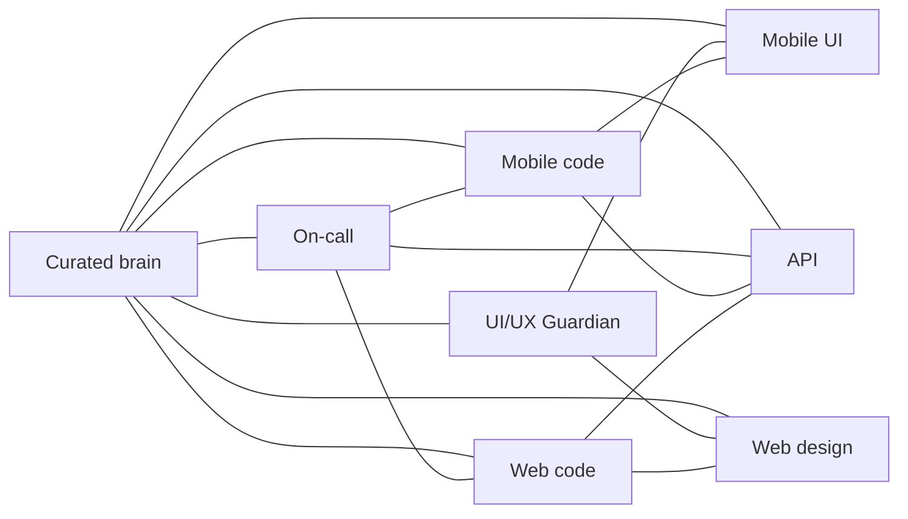

# Mini brains

Open one hub, then the review it names. For any new or changed UI, open the Guardian before the UI brain.

| Mini brain | Open when |
|---|---|
| [Mobile code](mobile-code.md) | A React Native screen, navigator, Realm, or `API.post` |
| [Mobile UI](mobile-ui.md) | Header, footer, type, color, a new mobile screen’s chrome |
| [Web code](web-code.md) | Laravel, Blade, manager islands, MCP PHP |
| [Web design](web-design.md) | Classic AdminLTE versus manager pixels |
| [API](api.md) | A path, a FormData key, a credit spend. Full route table: [API endpoints](api-endpoints.md) |
| [UI/UX Guardian](ui-ux-guardian.md) | Any new or changed UI |
| [On-call](on-call.md) | A production bug, a Sentry issue, or a customer report. Where errors land, triage, hotfix branches, and what an AI agent may do |

Role cards are not an eighth brain. They say who lands where: [User](../roles/user.md), [Manager](../roles/manager.md), [Admin](../roles/admin.md).

