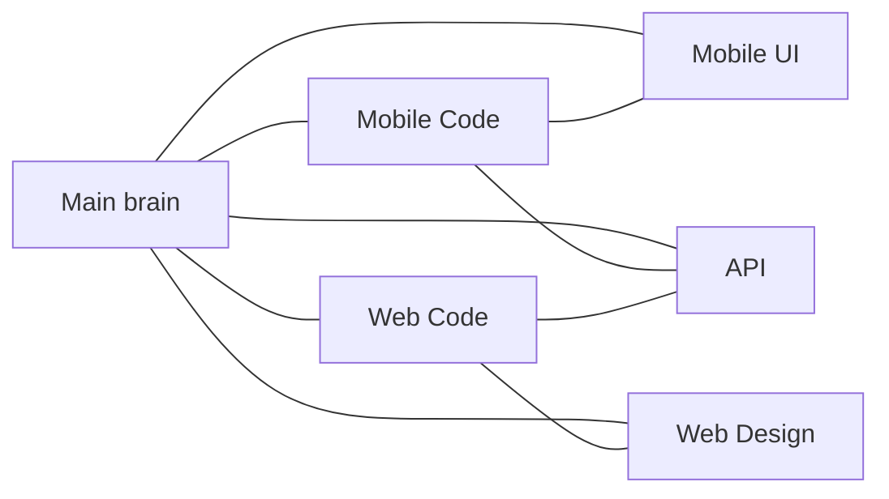

# Sub brains

The **main brain** is this vault plus the frontal lobe `../AI_BRAIN.md`. These five hubs do not replace it. They are the first stop when the task is clearly one surface.

**Do not invent** endpoints, FormData keys, credits, or MCP tools. `TerriTool/` and `webterritool/` win.

| Sub brain | Use when | Deep notes |
|-----------|----------|------------|
| [1. Mobile Code Brain](mobile-code.md) | RN screen, navigator, Realm, `API.post` | [code/mobile-code-details.md](../code/mobile-code-details.md) · [10-mobile-app.md](../10-mobile-app.md) |
| [2. Mobile UI Brain](mobile-ui.md) | Chrome, tokens, footer | [design/MINI-DESIGN-BRAIN.md](../design/MINI-DESIGN-BRAIN.md) |
| [3. Web Code Brain](web-code.md) | Laravel, `CompanylController`, MCP PHP, islands | [code/web-code-details.md](../code/web-code-details.md) · [11-web-backend.md](../11-web-backend.md) |
| [4. Web Design Brain](web-design.md) | Classic AdminLTE vs manager pixels | [design-web/MINI-DESIGN-BRAIN.md](../design-web/MINI-DESIGN-BRAIN.md) |
| [5. Web and Mobile API Brain](api.md) | JWT paths, web URLs, FormData, publish | [12-mobile-api.md](../12-mobile-api.md) · [13-web-urls.md](../13-web-urls.md) · [data/formdata-dictionary.md](../data/formdata-dictionary.md) |

Live code checks (2026-09-14): **46** stack screens; buy-contact **2 / 2 / 1** in `contactBuyCredits.js`; curved radius in `screenCurvedBody.js` not `theme.js`. Drift log: [05-constraints-and-drift.md](../05-constraints-and-drift.md).

