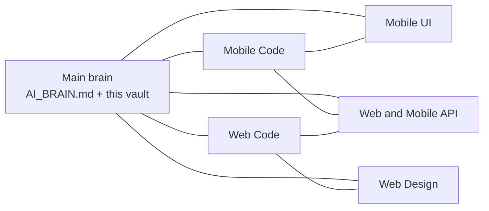

# Sub brains

The **main brain** is this vault plus the frontal lobe `../AI_BRAIN.md`. These five hubs do not replace it. They are the first stop when the task is clearly mobile code, mobile UI, web code, web UI, or APIs.

**Do not invent** endpoints, FormData keys, credits, or MCP tools. Code under `TerriTool/` and `webterritool/` wins over every note.

| Sub brain | Use when | Deep notes |
|-----------|----------|------------|
| [1. Mobile Code Brain](mobile-code.md) | New RN screen, navigator, Realm, Global, `API.post` | [code/mobile-code-details.md](../code/mobile-code-details.md) · [10-mobile-app.md](../10-mobile-app.md) |
| [2. Mobile UI Brain](mobile-ui.md) | Chrome, tokens, footer, copy nearest screen | [design/MINI-DESIGN-BRAIN.md](../design/MINI-DESIGN-BRAIN.md) |
| [3. Web Code Brain](web-code.md) | Laravel controller, Blade, MCP PHP, manager islands | [code/web-code-details.md](../code/web-code-details.md) · [11-web-backend.md](../11-web-backend.md) |
| [4. Web Design Brain](web-design.md) | Classic AdminLTE vs manager portal pixels | [design-web/MINI-DESIGN-BRAIN.md](../design-web/MINI-DESIGN-BRAIN.md) |
| [5. Web and Mobile API Brain](api.md) | JWT paths, web URLs, FormData, `createroute` publish | [12-mobile-api.md](../12-mobile-api.md) · [13-web-urls.md](../13-web-urls.md) · [data/formdata-dictionary.md](../data/formdata-dictionary.md) |

Product / credits / MCP still start at the frontal lobe and [09-credits-billing.md](../09-credits-billing.md) / [14-mcp.md](../14-mcp.md).

