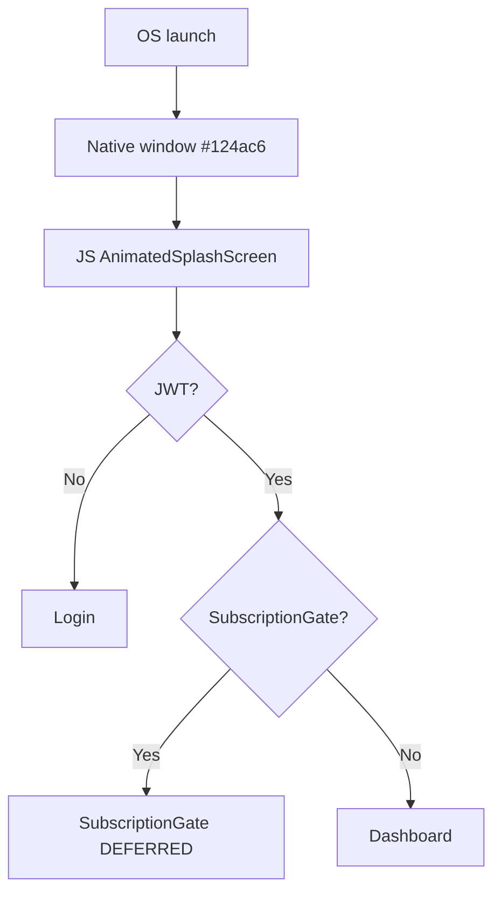

# App launch

JS overlay (`AnimatedSplashScreen.js`): `Image_splash.png` background + Lottie (`splash_icon.json` iOS / `splash_icon_android.json` Android). Fade in ~520ms, min visible **3000ms**, fade out ~450ms. Native launch is still solid `#124ac6` only.

Maestro `19-splash.png` is the **native solid blue window** (no poster, no Lottie). Asset still of the JS background: `/Users/dhruvdave/Downloads/Archive/Assets/splash/Image_splash.png`.

`launchScreen.jpeg` is a sibling marketing still and is **not** wired in JS.

**Needs Manual Verification:** Lottie motion on a real device (simulator shot did not catch the overlay).
