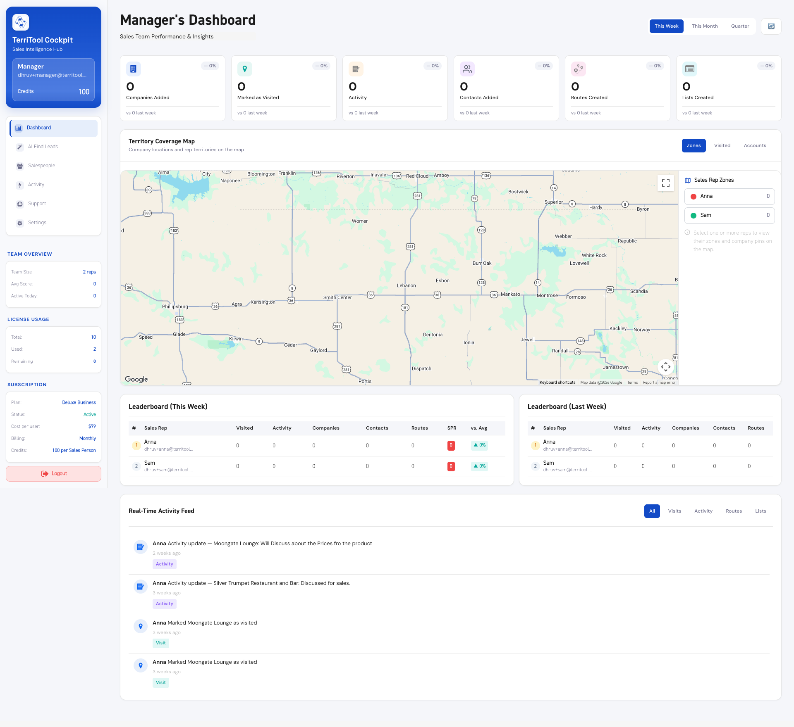

# Manager — Business Agent

Web home is `/manager/dashboard`. This is a different UI from the rep app. The companies they assign still land in a rep’s Address Book.

## What they do

- See team KPIs, territory, activity, licenses, and subscription on the cockpit.
- Run manager Find Leads (Places circles) and assign companies to a rep. The save spends manager credits. `user_id` on the company is the rep.
- Invite and edit salespeople, open support, change settings.
- They do not get Find MCP. They do get team tools on User MCP (`list_team`, `get_team_territories`, `recommend_lead_distribution`, `get_team_dashboard`, `get_team_activity`).

## Stack to copy

React islands in `resources/manager-portal/`, CSS variables in `public/css/manager-portal.css`. Read [web design](../brains/web-design.md) and [web code](../brains/web-code.md).

Open this still before drawing a manager screen:

More manager stills: [screenshots/web-owner/Manager](../screenshots/web-owner/Manager).

## Chrome on that still

Left sidebar, blue gradient brand card, team overview, license usage, subscription panel, six KPI cards, territory map, two leaderboards, activity feed. Type is DM Sans / Space Grotesk. Do not rebuild this as an AdminLTE page.

## Do not

- Put a Business Agent on the classic Find Leads page as if it were their personal CRM.
- Reuse classic `#16aa9d` or DIN 2014 for a new manager page.
- Expose `/hq`.
