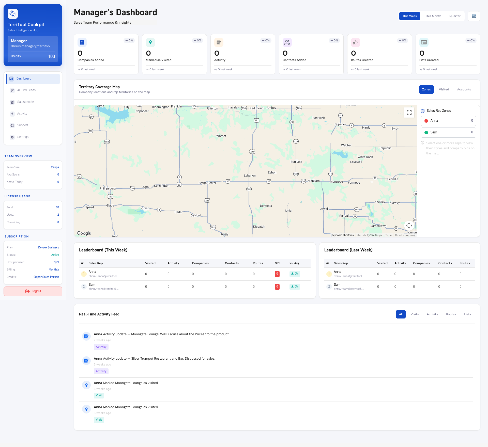
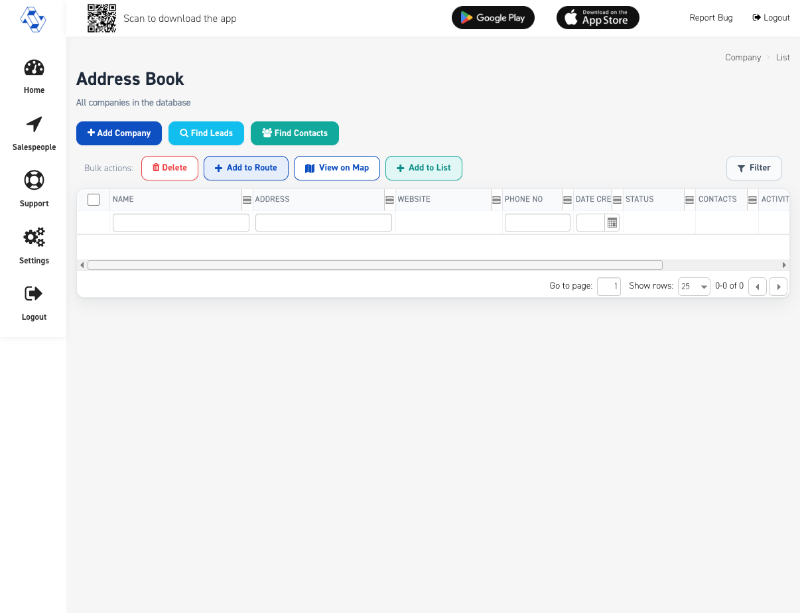

# Screenshot review

Open a still before generating UI. The image in this folder is the spec. The filename is often only a clock time.

When the job is to generate a screen, the handoff is a PNG of that screen. Rules: [UI/UX Guardian](../brains/ui-ux-guardian.md). Do not hand back an HTML page.

The owner set below is 233 stills across 10 flows, reviewed as a set on 2026-09-15, plus the 2026-09-22 Dashboard still, plus 10 Voice Mode stills from the 2026-09-28 QA run. Each flow folder’s first clean frame is the one to open. Frames that are permission sheets, loaders, or failures are called out in the filename table.

Method:

1. Pick the surface in [the Guardian](../brains/ui-ux-guardian.md).
2. Open the folder below that matches the job.
3. Look at the pixels. Copy header, type, spacing, and empty states from that image and from the sibling screen in the code review.
4. If a filename and the pixels disagree, follow the pixels.

Fonts and icons to use with these stills: [assets/fonts](../assets/fonts), [assets/icons](../assets/icons). Do not download a new font.

## Mobile — owner simulator set

iPhone 17 Pro Max simulator, 2026-09-15. 233 stills. Folder name is the flow. The file name is a timestamp.

| Flow | Stills | Copy when you are building | Open |
|---|---|---|---|
| Login and registration | 21 | Login, register, paywall | [LoginRegistrationFlow](mobile-owner/LoginRegistrationFlow) |
| Dashboard | 11 | Home tiles, activity, QR, review rewards | [Dashboard](mobile-owner/Dashboard) |
| Activity and calendar | 4 | Calendar and recent activity | [ActivityCalendar](mobile-owner/ActivityCalendar) |
| AI Find Leads | 49 | Find Leads search, select, confirm | [AIFindLeadsFlow](mobile-owner/AIFindLeadsFlow) |
| Add company | 9 | Create company | [AddCompany](mobile-owner/AddCompany) |
| Scan card | 11 | Business card scan | [ScanCardFlow](mobile-owner/ScanCardFlow) |
| Address Book | 18 | Company list and company detail | [AddressBookFlow](mobile-owner/AddressBookFlow) |
| Routes | 81 | Route library, create, detail, map | [RouteFlow](mobile-owner/RouteFlow) |
| Lists | 42 | List library and detail | [List](mobile-owner/List) |
| Settings | 7 | Settings, plan, credits | [Setting](mobile-owner/Setting) |
| Voice Mode | 10 | Voice screen states and cards, Voice history, the Settings card, the mini-bar on route detail | [VoiceMode](mobile-owner/VoiceMode) |

Voice Mode stills come from `TerriTool/qa/voice-mode-2026-09-28/evidence/`: same simulator, staging, a dev build, 368 × 800. The file names say what each shows. The “Refreshing…” strip at the top of several is the dev build’s refresh banner. Do not draw it. In `10-connection-error` that strip covers the state card. There is no still yet for the Dashboard row or the first-run sheet. For those, use the renders listed on [22 — Voice Mode](../features/22-Voice-Mode.md).

Home chrome to copy is the 2026-09-22 1:45 still: black bezel, small island in the status bar, credits pill, six tiles, empty Upcoming, and “Tue, Sep 22 · 8:15 AM PT”. That still’s banner still says “Want 20 more credits?”. In the store build (`Production`) the banner is “Unlock 50 Credits.” with its subtitle commented out (`e91a86c9`), and `TT_80` removed it (`fe2e3254`). It opens the review sheet: [ready](mobile-owner/Dashboard/review-rewards-ready.png), [both pending](mobile-owner/Dashboard/review-rewards-pending.png), [G2 verified](mobile-owner/Dashboard/review-rewards-g2-verified.png). The island does not cover the header. The 12:56 still is the same home a few minutes earlier. The 19.36.33 still is that home with activity rows. The 19.36.28 still is the OS location prompt. The 19.37.00 still shows “Invalid Date PT”. That string is a bug.

AI Find Leads at 19.42.05 is the search form under “Loading your saved AI leads…”. Copy the form around the spinner. Do not replace it with a new map or a chat screen.

## Filename lies

These names have been checked against the pixels. If you meet the file, believe the right-hand column.

| File name suggests | Pixels actually show |
|---|---|
| `02-home/02-dashboard-add-menu.png` | Address Book plus the add menu (Add Company / Find Leads). The Address Book add menu is `04-companies/04-address-book-add-menu.png`. |
| `01-auth/08-subscription-gate.png` | The same RevenueCat paywall as the subscription screen, including Log out (Dev). Not a separate gate layout. |
| `01-auth/01-login-forgot-password.png` | Safari on staging, Reset Password. Forgot Password opens the web reset URL. |
| `03-find-leads/07-ai-save-to-list.png` | Selected Leads plus Confirm Leads. Not the add-to-list sheet. |
| `09-settings/08-whats-new.png` | “New Update Available”. Not a changelog. |
| `07-routes/14-route-swipe.png` | A stub that says swipe back. Not shipping chrome. |
| `07-routes/11-publish-route.png` | “Generating Route Failed!!” |
| `07-routes/12-edit-publish-route.png` | “Creating Route Failed!!” |
| `06-lists/03-lists-filter.png` and `07-routes/05-routes-filter.png` | Legacy teal FilterList / FilterRoute. Do not copy. The live filter is FilterModule. |
| `09-settings/03-settings-plan-paywall.png` | “Manage your plan on the web”. |
| `09-settings/04-settings-buy-credits.png` | Safari Buy Credit Add-Ons on staging. |

Do not invent: a distinct SubscriptionGate layout, an in-app App Store purchase sheet for a web-billed account, a lasso finger-draw that was not captured, or a successful publish loader if the still in hand is the failure card.

## Web — three surfaces

| Surface | Folder | What a future screen must match |
|---|---|---|
| Manager cockpit | [web-owner/Manager](web-owner/Manager) | Sidebar, gradient brand card, KPI row, map, leaderboards. React. |
| Admin HQ | [web-owner/Admin](web-owner/Admin) | Backpack tables and HQ chrome. |
| Rep web | [web-owner/Salespeople](web-owner/Salespeople) and [web/sales-agent](web/sales-agent) | AdminLTE, Source Sans Pro, DIN. |
| Classic stills, short | [web-stills](web-stills) | Named files below. |

Manager dashboard to copy:

Classic Address Book to copy:

Other short stills in `web-stills/`:

| File | Surface |
|---|---|
| [01-manager-dashboard.png](web-stills/01-manager-dashboard.png) | Manager |
| [02-manager-ai-find-leads.png](web-stills/02-manager-ai-find-leads.png) | Manager Find Leads |
| [03-manager-ai-circles.png](web-stills/03-manager-ai-circles.png) | Manager map circles |
| [05-classic-findleads.png](web-stills/05-classic-findleads.png) | Classic Find Leads |
| [06-classic-routes-list.png](web-stills/06-classic-routes-list.png) | Classic routes |
| [07-classic-route-wizard-step1.png](web-stills/07-classic-route-wizard-step1.png) | Classic route wizard |
| [review-credits-desktop.png](web/sales-agent/review-credits-desktop.png) | Classic Unlock 50 free credits, wide |
| [review-credits-phone.png](web/sales-agent/review-credits-phone.png) | Same page, phone width |

`web/business-agent`, `web/business-sales-agent`, and `web/public` are additional captures of those roles. Use them when the owner folder does not contain the screen.

## Feature evidence

Per-module stills, including web staging captures and mobile simulator frames, are in [feature-evidence](feature-evidence). Each feature page links the first stills. The capture time in the filename is not the layout name. Read the feature page’s screen column, then open the image.

## Videos

Walkthrough video files are stored in this same B1 tree:

- [territool-brain videos](../archive/territool-brain/brain/assets/videos)
- [TerriTool evidence videos](../archive/TerriTool-AI-Brain/evidence/video)

A video does not replace the still. Generate from the still.
